# DataAgent 产品文档

> **目标读者**：数据产品工程师、产品经理、解决方案架构师
> **文档版本**：v1.0 ｜ **基准代码**：spring-ai-alibaba/DataAgent（Spring Boot 3.4.8+ / Spring AI Alibaba 1.1.2.2）
> **一句话定位**：DataAgent 是一个企业级"AI 智能数据分析师"——用户用自然语言提问，系统自动完成 意图识别 → 知识检索 → SQL 生成 → 数据查询 → Python 深度分析 → 图表报告生成 的全链路，并支持人工审核、MCP 对外服务与 API 集成。

---

## 目录

1. [产品概述](#1-产品概述)
2. [用户画像与核心场景](#2-用户画像与核心场景)
3. [产品功能全景](#3-产品功能全景)
4. [核心业务流程](#4-核心业务流程)
5. [智能体（Agent）生命周期](#5-智能体agent生命周期)
6. [知识体系：让 AI 懂业务的三层配置](#6-知识体系让-ai-懂业务的三层配置)
7. [运行模式详解](#7-运行模式详解)
8. [开放能力：API 与 MCP](#8-开放能力api-与-mcp)
9. [非功能性能力（安全/可观测/部署形态）](#9-非功能性能力)
10. [功能边界与已知限制](#10-功能边界与已知限制)
11. [典型实施路线图建议](#11-典型实施路线图建议)

---

## 1. 产品概述

### 1.1 解决什么问题

传统数据分析链路存在三大痛点：

| 痛点 | 传统方式 | DataAgent 的解法 |
| :--- | :--- | :--- |
| 取数门槛高 | 业务人员提需求 → 数据工程师写 SQL，排队数小时甚至数天 | 自然语言直接提问，Text-to-SQL 自动生成并执行 |
| 深度分析弱 | SQL 只能做聚合，复杂统计/建模需要导出到 Python | 工作流内嵌 Python 沙盒节点，自动生成并执行分析代码 |
| 报告产出慢 | 数据到手后还需人工做图、写解读 | 自动生成带 ECharts 图表的 HTML/Markdown 报告，可下载 |

### 1.2 产品形态

DataAgent 由三部分组成：

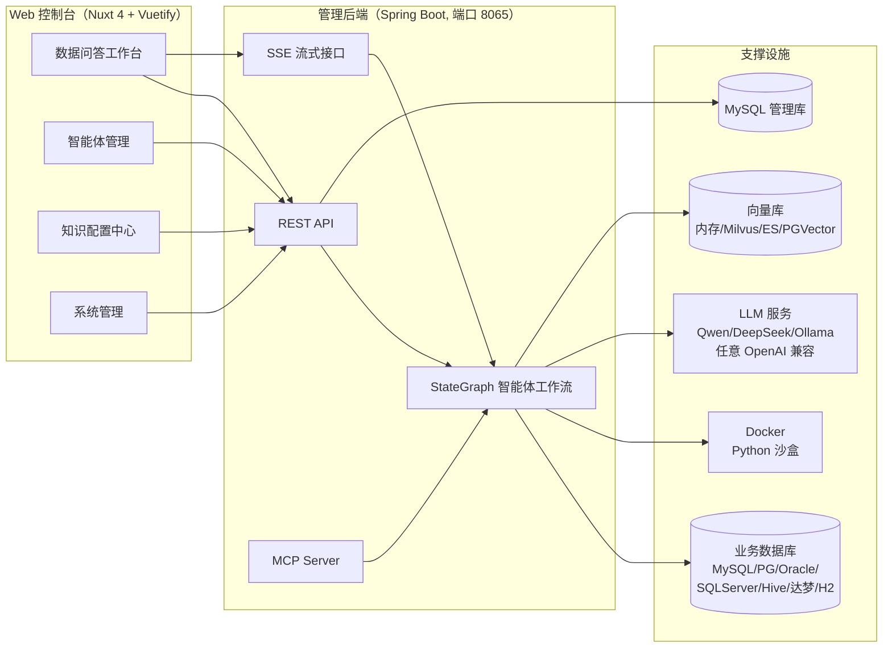

- **Web 控制台**（`data-agent-frontend-nuxt`）：面向数据产品工程师/业务分析师的配置与使用界面，访问 `http://localhost:3000`。
- **管理后端**（`data-agent-management`）：承载 REST API、SSE 流式问答、StateGraph 工作流引擎、MCP Server，默认端口 `8065`。
- **支撑设施**：MySQL 管理库（存智能体/知识/会话等元数据）、被分析的业务数据库、向量数据库（RAG）、Docker（Python 沙盒）、大模型服务。

### 1.3 核心特性一览

| 特性 | 说明 | 产品价值 |
| :--- | :--- | :--- |
| 智能数据分析 | 基于 StateGraph 的多节点 Text-to-SQL 工作流，支持多表 JOIN、多轮对话意图理解 | 复杂问题一次问对 |
| Python 深度分析 | 任务级 Docker 沙盒执行 LLM 生成的 Python，支持 PEP 723 动态依赖、资源限制、失败重试 | 预测/归因/复杂统计不再需要导出数据 |
| 智能报告生成 | 自动汇总为含 ECharts 图表的 HTML/Markdown 报告，所见即所得，可下载 | 分析结论直接可用于汇报 |
| 人工反馈（Human-in-the-loop） | 计划生成后暂停，等待用户"同意/拒绝+修改意见"，拒绝则重新规划 | 关键报表可控、可审、可纠偏 |
| RAG 检索增强 | 业务知识、智能体知识（文档/Q&A）向量化召回，注入生成过程 | 口语化提问也能命中准确口径 |
| 语义模型 | 业务术语 ↔ 物理表字段的双向映射（含同义词） | "销售额"能准确映射到 `price2` 这类字段 |
| 多模型调度 | 模型注册表支持运行时热切换 Chat/Embedding 模型，兼容 OpenAI 协议 | 不锁定厂商，私有化模型可平滑接入 |
| 多数据源 | 对外支持 6 种标准 JDBC：MySQL、PostgreSQL、达梦、SQL Server、Oracle、Hive | 兼容国产化与大数据环境 |
| 逻辑外键 | 手工登记表间关联关系，弥补无物理外键的库 | 多表 JOIN 准确率显著提升 |
| MCP Server | 对外提供 `nl2SqlToolCallback`、`listAgentsToolCallback` 两个工具 | 可嵌入 Claude Desktop 等 MCP 生态 |
| API Key 管理 | 智能体维度生成/重置/启停 API Key；内置鉴权链保护流式问答端点（`X-API-Key` 请求头） | 开放能力开箱可用 |
| 可观测性 | Langfuse（OpenTelemetry 协议）追踪每次运行的 Token 用量、节点耗时、错误 | 成本可算、问题可查 |

---

## 2. 用户画像与核心场景

### 2.1 用户画像

| 角色 | 使用方式 | 高频操作 |
| :--- | :--- | :--- |
| **数据产品工程师**（首要用户） | 建智能体、接数据源、配知识、发布运营 | 创建智能体、语义模型、业务知识、逻辑外键 |
| 业务分析师 | 在问答工作台提问、下载报告 | 提问、开启人工反馈、切换 NL2SQL 模式 |
| 应用开发者 | 通过 API / MCP 把能力嵌入自家系统 | API Key 管理、MCP 工具调用 |
| 平台管理员 | 配模型、管数据源 | 模型配置、数据源连接管理 |

### 2.2 核心用户旅程

**旅程一：从零到第一次提问（配置旅程）**

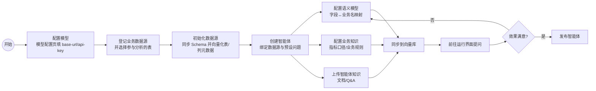

**旅程二：一次数据问答（使用旅程）**

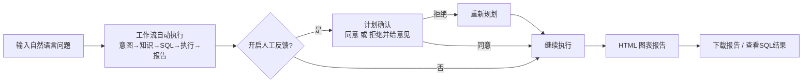

---

## 3. 产品功能全景

### 3.1 功能地图（对应前端页面）

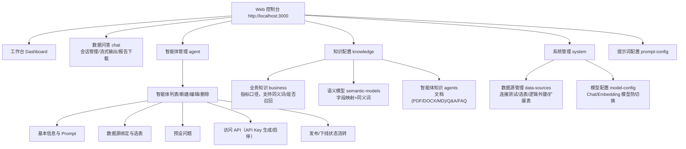

### 3.2 智能体管理

- **状态机**：`draft（待发布）→ published（已发布）→ offline（已下线）`，可再次发布。
- 每个智能体独立拥有：数据源绑定、预设问题、语义模型、业务知识、智能体知识、提示词覆盖配置。
- 智能体维度生成 `sk-xxx` 格式 API Key，可启用/禁用/重置/删除。

### 3.3 数据源管理

| 能力 | 说明 |
| :--- | :--- |
| 多类型接入 | 对外支持 6 种标准 JDBC：MySQL、PostgreSQL、达梦（Dameng）、SQL Server、Oracle、Hive（引擎内置 H2 兜底及更多扩展类型） |
| 连接测试 | 保存后可验证连通性（test_status：success/failed/unknown） |
| 选表机制 | 按智能体×数据源粒度勾选参与分析的表（`agent_datasource_tables`） |
| 初始化 | 抽取表/列 Schema → 向量化写入向量库，供后续"Schema 召回"；更换嵌入模型后需重新初始化 |
| 逻辑外键 | 登记逻辑关联（源表.字段=目标表.字段，1:1 / 1:N / N:1），在 Schema 召回时合并进外键信息 |
| 扩展表管理 | 管理数据源下参与召回的表清单 |

### 3.4 数据问答工作台

- 左侧会话列表（新建/置顶/归档，标题由系统异步自动生成），右侧对话区 + 请求参数区。
- **工作流时间线**：实时展示当前执行到哪个节点（意图识别/证据召回/SQL 生成/Python 执行/报告生成…），同名节点多次尝试以"尝试次数"呈现。
- **流式输出**：Token 级流式渲染；按内容类型（JSON/SQL/HTML/Markdown/Python/结果集）分区渲染。
- **报告下载**：最终 HTML 报告可一键下载（内嵌 ECharts，离线可看）。
- **运行模式**（见第 7 节）：默认 / 人工反馈 / 仅 NL2SQL / 简洁报告 / 显示 SQL 结果。

### 3.5 模型配置

- 模型类型分 `CHAT`（对话）与 `EMBEDDING`（向量化）两类，各自同时仅一个"激活"模型生效。
- 配置项：厂商标识、base-url、api-key、模型名、温度、max-tokens、completions-path / embeddings-path、代理设置。
- 兼容一切 OpenAI 协议服务：Qwen、DeepSeek、OpenAI、Ollama、自建网关（如 `http://localhost:11434/v1/chat/completions`）。

---

## 4. 核心业务流程

### 4.1 端到端主流程（产品视角）

用户的一次提问，在系统内部经过 16 个工作流节点的编排（详情见开发文档）。产品视角下可归纳为 6 个阶段：

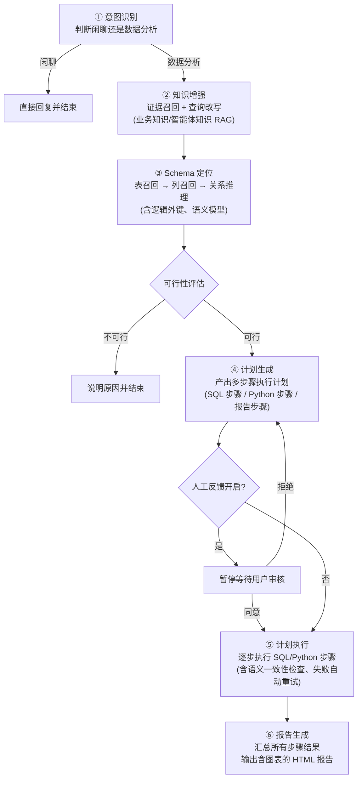

**产品要点**：

- **自动重试**：SQL 生成失败/执行报错会带着错误信息自动重试（默认最多 10 次）；Python 失败同样反馈重生成（默认最多 5 次）。用户在时间线上能看到每一次尝试。
- **多轮上下文**：追问（如"那上个月呢？"）会自动结合历史对话改写为独立问题。
- **仅 NL2SQL**：计划直接收敛为"SQL 生成→执行→结束"，不产报告，适合把 DataAgent 当取数工具用。

### 4.2 人工反馈时序（产品视角）

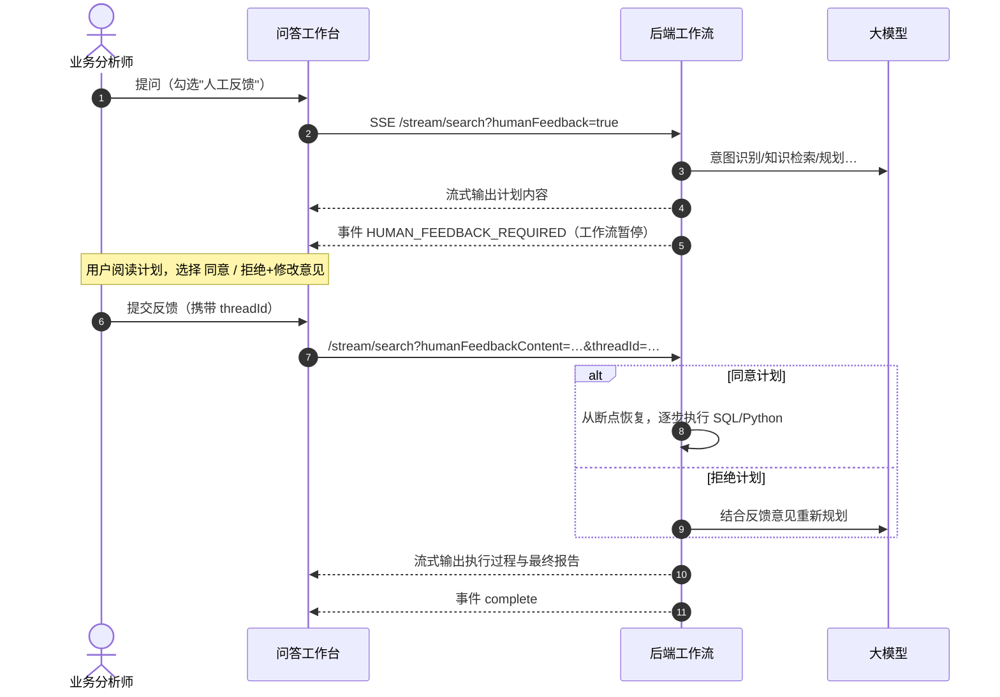

### 4.3 Python 深度分析流程（产品视角）

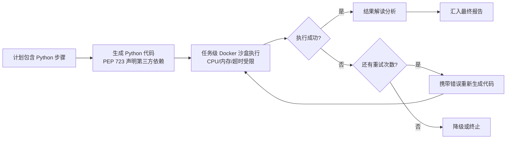

- 每次任务独立容器，执行完毕自动清理（不留残余容器）。
- 依赖（如 `pandas`、`six==1.17.0`）由代码内 PEP 723 注释声明，沙盒内自动安装。
- 安全边界：容器非特权运行，限制 CPU 1 核/内存 500MB/超时 60s；生产建议私有 PyPI 代理。

---

## 5. 智能体（Agent）生命周期

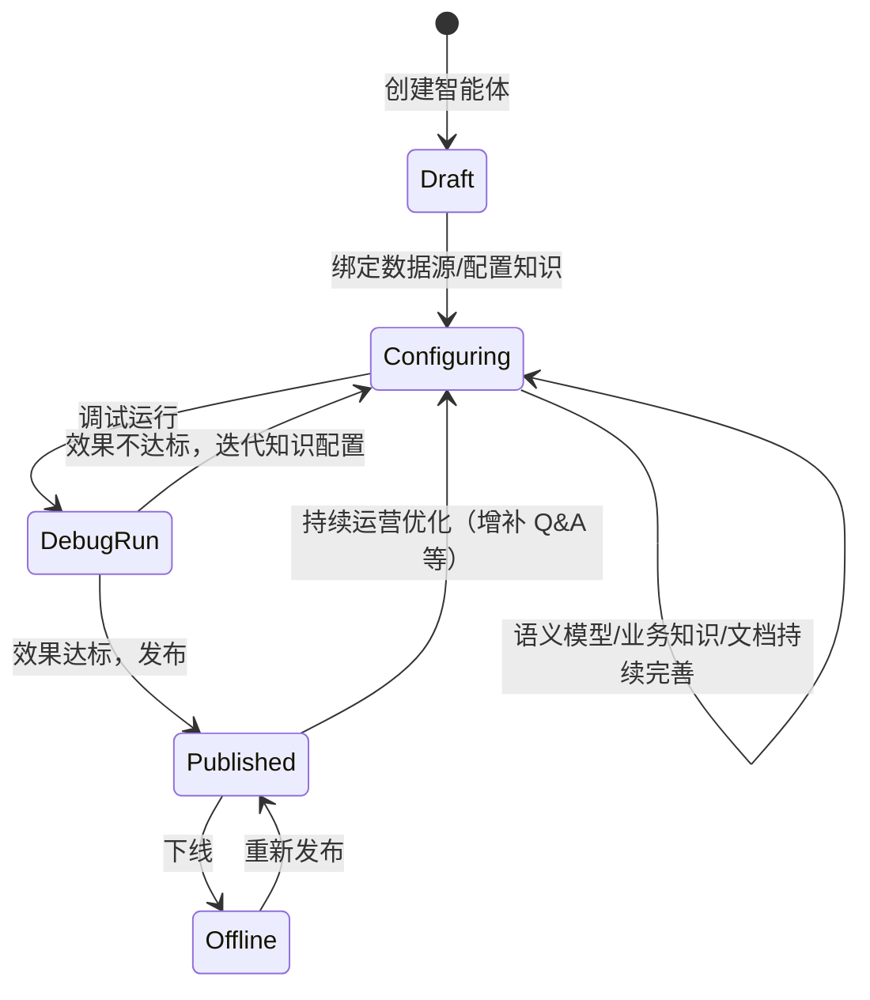

**配置-调优闭环（运营建议）**：上线不是终点。建议建立"坏例（Bad Case）→ 知识补丁"机制：每次 SQL 答错，优先补一条 **Q&A 智能体知识**（问题+标准 SQL），其次补**语义模型同义词**或**业务知识口径**，而不是反复改提示词。

---

## 6. 知识体系：让 AI 懂业务的三层配置

这是数据产品工程师的**核心运营阵地**，直接决定问答准确率。

### 6.1 三层知识定位对比

| 层 | 回答的问题 | 典型内容 | 生效位置 |
| :--- | :--- | :--- | :--- |
| **语义模型** | "这个词对应哪张表哪个字段？" | `csat_score` → "客户满意度分数"，同义词"满意度/客户评分" | Schema 定位、SQL 生成 |
| **业务知识** | "这个指标怎么算？" | "GMV=已支付+已发货订单金额，不扣退款" | 证据召回 → 查询改写 → SQL 生成 |
| **智能体知识** | "有没有背景资料/范例？" | PDF/DOCX/MD 文档、Q&A 问答对、FAQ | 全流程（规划/SQL/报告） |

### 6.2 配置决策树

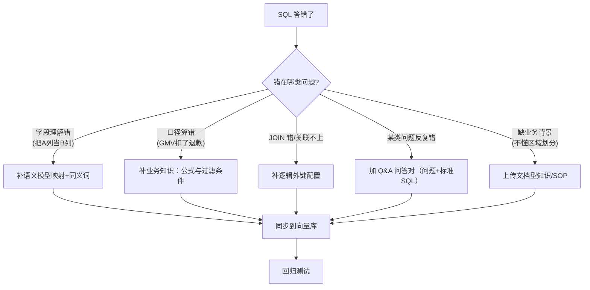

### 6.3 知识生效时序

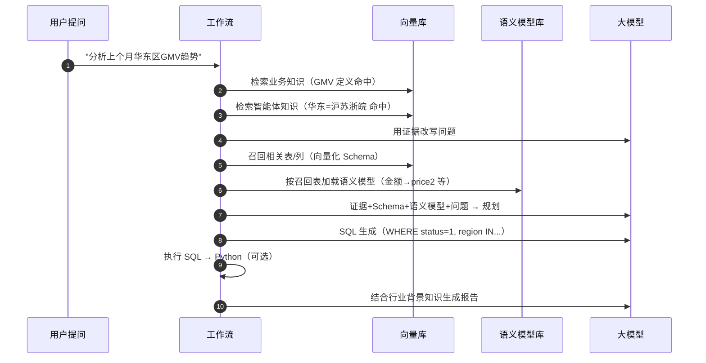

### 6.4 配置规范速查（避坑清单）

1. **语义模型只做映射，不写计算逻辑**；公式一律放业务知识。
2. **枚举字段必须解释取值**：如"order_status：0 待支付，1 已支付，2 已取消，3 退款中；GMV 只统计 1"。
3. **同义词克制使用**，只收口语化常见叫法，避免误召回。
4. **描述要"讲人话"**：把 LLM 当新来的实习生，避免内部黑话。
5. **Q&A 是救火队**：反复答错的问题，配一条 Q&A（含标准 SQL/思维链）见效最快。
6. 修改业务知识/智能体知识后，**务必点击"同步到向量库"**。

---

## 7. 运行模式详解

| 模式 | 触发方式 | 行为 | 适用场景 |
| :--- | :--- | :--- | :--- |
| 默认模式 | 不勾选任何选项 | 自动规划→执行→出报告 | 日常自助分析 |
| 人工反馈 | 勾选"人工反馈" | 计划生成后暂停，等用户同意/拒绝 | 关键报表审核、教学演示 |
| 仅 NL2SQL | 勾选"仅NL2SQL" | 只生成并执行 SQL，不出报告 | 把 DataAgent 当取数 API |
| 简洁报告 | 报告风格参数 | 输出精简版报告 | 快速结论 |
| 显示 SQL 结果 | 勾选"显示SQL运行结果" | 报告中附带原始结果集表格 | 数据核对、二次加工 |

> 组合关系：人工反馈与仅 NL2SQL 互斥（后端 `humanReviewEnabled = humanFeedback && !nl2sqlOnly`）。

---

## 8. 开放能力：API 与 MCP

### 8.1 REST API 地图（`/api` 前缀）

| 分组 | 端点前缀 | 能力 |
| :--- | :--- | :--- |
| 流式问答 | `GET /api/stream/search`（SSE）、`POST /api/stream/stop` | 发起/终止一次问答运行 |
| 会话 | `POST /api/agent/{agentId}/sessions`、`/api/sessions/{id}/messages` 等 | 会话与消息管理 |
| 智能体 | `/api/agent` | CRUD、发布/下线、API Key、预设问题 |
| 数据源 | `/api/datasource`、`/api/agent/{agentId}/datasources` | 连接管理、选表、逻辑外键、初始化 |
| 知识 | `/api/business-knowledge`、`/api/agent-knowledge`、`/api/semantic-model` | 三层知识 CRUD 与向量化同步 |
| 模型 | `/api/model-config` | Chat/Embedding 模型配置与激活 |
| 提示词 | `/api/prompt-config` | 按类型/智能体覆盖内置提示词 |
| 文件 | `/api/upload` | 知识文档上传 |
| 接口文档 | `/swagger-ui.html`、`/v3/api-docs` | OpenAPI 在线文档 |

**API Key 使用约定**：请求头 `X-API-Key: sk-xxx`（或 `Authorization: Bearer sk-xxx`）。
> **产品须知**：内置鉴权链（WebFlux Security）当前仅保护流式问答端点 `GET /api/stream/search`——当智能体的 `api_key_enabled=1` 时该端点必须携带有效 Key（失败返回 401）；`=0` 时匿名放行。其余 REST 端点未纳入鉴权范围，对外开放管理端点前建议自行扩展拦截范围。

### 8.2 MCP Server

- 端点：`http://<host>:8065/sse`（可用 `spring.ai.mcp.server.sse-endpoint` 自定义）。
- 工具清单：

| 工具名 | 功能 | 入参 |
| :--- | :--- | :--- |
| `nl2SqlToolCallback` | 自然语言 → SQL | `agentId`、`naturalQuery` |
| `listAgentsToolCallback` | 查询智能体列表 | `keyword`、`status`（draft/published/offline） |

- 本地调试：`npx @modelcontextprotocol/inspector http://localhost:8065/mcp/connection`
- 集成示例：Claude Desktop 等支持 MCP 的客户端可直接把 DataAgent 当作"取数工具"挂载。

### 8.3 集成场景示意

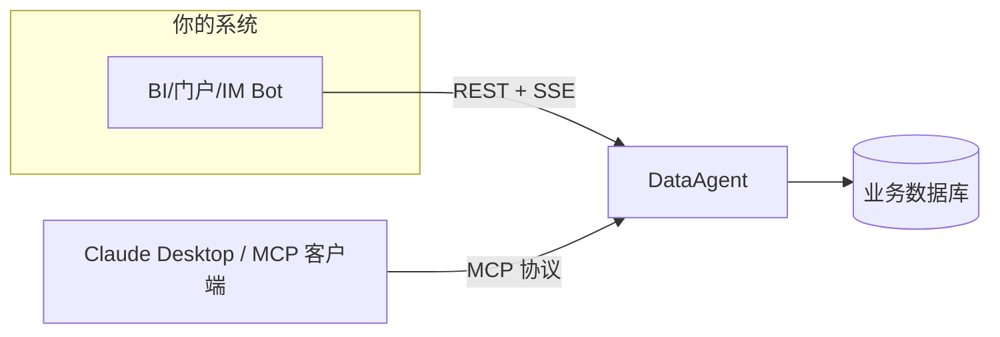

---

## 9. 非功能性能力

### 9.1 安全

| 维度 | 现状 | 生产建议 |
| :--- | :--- | :--- |
| 数据源凭据 | 密码字段存储于管理库 | 管理库访问控制 + 网络隔离 |
| Python 沙盒 | 任务级容器、非特权、CPU/内存/超时/IO 限制、自动清理 | 固定镜像 digest、私有 PyPI 代理、禁注凭据、代理侧恶意包扫描 |
| API Key | 管理能力 + 流式问答端点鉴权（bcrypt 存储、启用开关） | 按需扩展鉴权到更多端点后再对外开放 |
| SQL 执行 | 业务库建议只读账号 | 最小权限原则 |

### 9.2 可观测性（Langfuse）

- 通过 OpenTelemetry 上报：运行级根 Span + 节点级 Span，含 Token 用量（prompt/completion）、错误信息。
- 配置：`LANGFUSE_ENABLED / LANGFUSE_HOST / LANGFUSE_PUBLIC_KEY / LANGFUSE_SECRET_KEY`；关闭时零开销（noop 实现）。

### 9.3 部署形态

| 组件 | 最低要求 | 说明 |
| :--- | :--- | :--- |
| 后端 | JDK 17+，MySQL 5.7+ | `./mvnw -pl data-agent-management spring-boot:run` |
| 前端 | Node.js 22+，pnpm 11+ | `pnpm install && pnpm dev`（3000 端口） |
| Docker | 需执行 Python 步骤时必需 | 纯 SQL 分析可不部署 |
| 向量库 | 可选 | 默认内存向量库；生产建议 Milvus/ES/PGVector（内置 Profile 一键切换） |

---

## 10. 功能边界与已知限制

| 项 | 说明 |
| :--- | :--- |
| API Key 鉴权范围 | 内置鉴权仅覆盖 `GET /api/stream/search`；其余管理端点开放前需自行扩展 |
| 访问 API | 智能体详情中"访问 API"入口为二次开发预留，尚未完全实现 |
| PEP 723 `requires-python` | 会被解析保留，但**不会**据此切换沙盒 Python 版本 |
| 依赖声明 | 仅支持包名+版本约束；URL/VCS/本地路径/环境标记/pip 参数会被拒绝 |
| 沙盒网络 | SAA 1.1.2.2 无"安装后断网"公开 API，需在网络层（只允许私有 PyPI）兜底 |
| 并发沙盒 | 默认最大并发 4、排队 10，超出报 `Python sandbox capacity is exhausted` |
| 向量库维度 | 切换持久化向量库时需将 `embedding-dimension` 与嵌入模型维度对齐（如 1024） |

---

## 11. 典型实施路线图建议

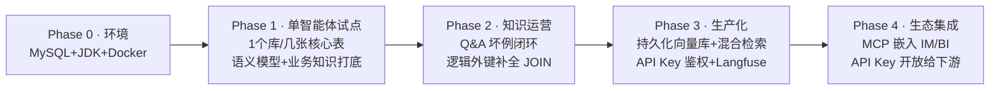

**每阶段验收口径**：
- P1：核心报表问题 80% 一次答对；
- P2：坏例回归全部通过；多表 JOIN 问题准确率明显提升；
- P3：SSE 全链路无残留容器、Langfuse 可查每次运行 Token 成本；
- P4：外部系统经 API/MCP 调用稳定，权限可控。

---

## 附：与本项目其他文档的关系

| 文档 | 侧重 |
| :--- | :--- |
| `产品文档.md`（本文） | 功能、场景、流程、运营 |
| `开发文档.md` | 架构、模块、工作流实现、扩展开发 |
| `学习文档.md` | 零基础入门、概念科普、动手实验 |
