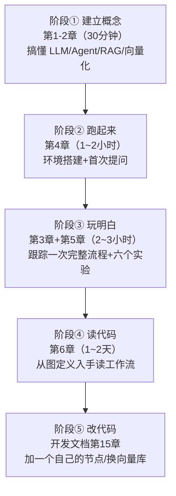
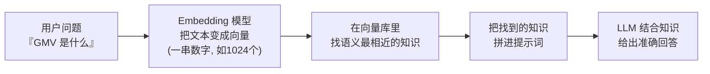
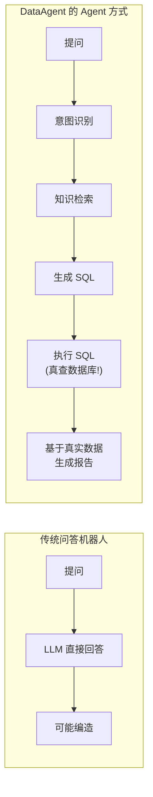
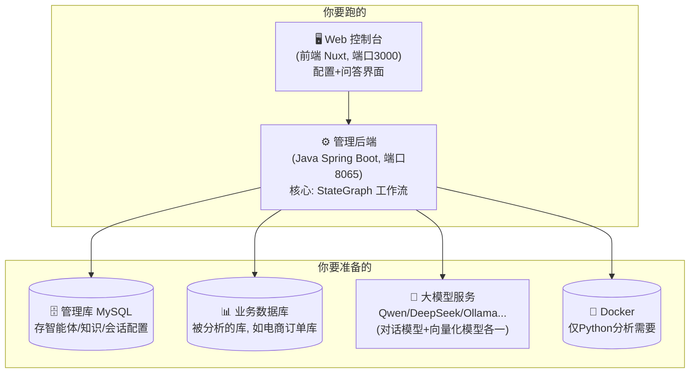
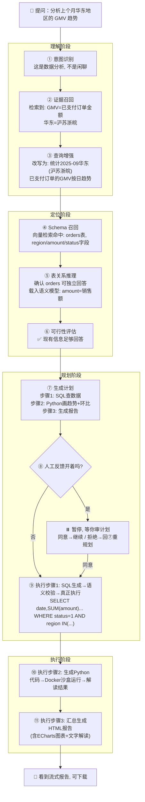
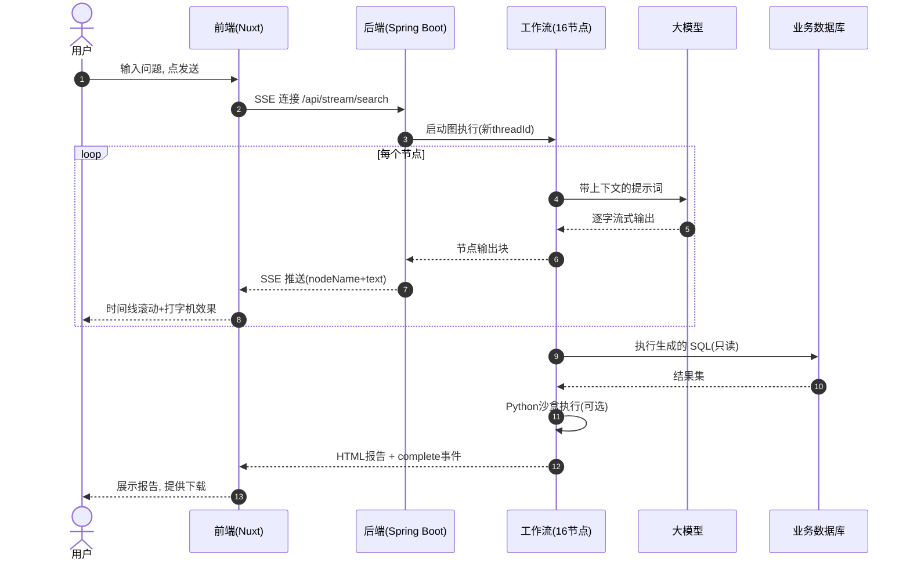
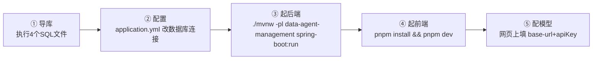
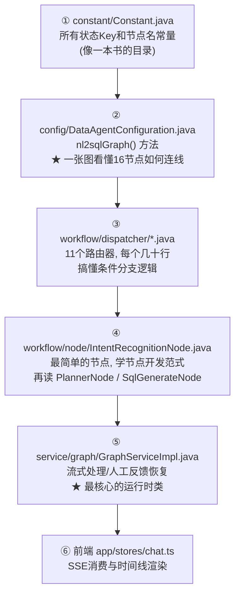

# DataAgent 学习文档（初学者视角）

> **目标读者**：第一次接触 AI Agent / Text-to-SQL / RAG 的学习者。不需要你是算法专家，只要会一点 Java 或 JavaScript、用过数据库，就能跟着本文走完全程。
> **学习目标**：读完本文，你能①看懂 DataAgent 是什么、解决什么问题；②把项目跑起来；③理解"自然语言是怎么变成 SQL 和报告的"；④动手做 6 个由浅入深的实验；⑤知道下一步该学什么。
> **配套文档**：功能与场景见 `产品文档.md`；架构与代码细节见 `开发文档.md`。

---

## 目录

- [第 0 章 · 学习路线图](#第-0-章--学习路线图)
- [第 1 章 · 先搞懂 6 个基础概念](#第-1-章--先搞懂-6-个基础概念)
- [第 2 章 · DataAgent 全景：它到底做了什么](#第-2-章--dataagent-全景它到底做了什么)
- [第 3 章 · 一次提问的完整旅程（逐步拆解）](#第-3-章--一次提问的完整旅程逐步拆解)
- [第 4 章 · 动手实战：环境搭建](#第-4-章--动手实战环境搭建)
- [第 5 章 · 动手实战：六个递进实验](#第-5-章--动手实战六个递进实验)
- [第 6 章 · 代码地图：想读代码从哪里下手](#第-6-章--代码地图想读代码从哪里下手)
- [第 7 章 · 常见问题与排错（FAQ）](#第-7-章--常见问题与排错faq)
- [第 8 章 · 术语表](#第-8-章--术语表)
- [第 9 章 · 进阶学习资源](#第-9-章--进阶学习资源)

---

## 第 0 章 · 学习路线图



**给不同背景读者的建议**：
- 会 Java / Spring：直接看第 6 章代码地图，工作流部分会非常亲切（就是状态图+回调）。
- 会 Python / 数据分析：重点看第 3 章的 SQL/Python 双引擎设计和第 5 章实验 5。
- 纯产品/运营背景：第 1、2、3 章 + 实验 1~3 就够了，第 4 章可请同事协助。
- 学生/转行者：按顺序走完，第 8 章术语表随时回查。

---

## 第 1 章 · 先搞懂 6 个基础概念

### 1.1 大语言模型（LLM）—— 会"接话"的超级实习生

LLM（如 Qwen 通义千问、DeepSeek、GPT）本质是一个"文本接龙机器"：你给它一段话（**Prompt，提示词**），它预测最可能的下文。它有两大特点：

1. **它不知道你的公司数据**。它训练时没见过你的订单表，所以你问"上月 GMV 多少"，它只会瞎编一个 SQL——除非你把表结构、指标口径"喂"给它。
2. **它每次回答都可能不一样**（温度参数 >0 时）。所以工程上需要"校验+重试"机制兜底。

> 💡 **类比**：把 LLM 当成一个刚入职、智力超群但不了解你公司的实习生。DataAgent 整个系统，本质上就是在做两件事：**把该给的信息喂给它**（知识检索），**把它的产出管起来**（校验、重试、人工审核）。

### 1.2 Text-to-SQL —— 从"人话"到"数据库话"

把自然语言翻译成 SQL。难点不在语法，而在**语义对齐**：

| 用户说 | 系统需要知道 |
| :--- | :--- |
| "上个月的销售额" | `销售额`=哪张表哪个字段？`上月`=相对当前时间怎么算？是否含未付款订单？ |
| "华东地区" | `华东`包含哪些省份？对应哪个字段？ |
| "高价值用户" | 这个词在你公司的定义是什么？ |

DataAgent 的解法是**三层知识配置**（语义模型/业务知识/智能体知识），详见 `产品文档.md` 第 6 章。

### 1.3 RAG（检索增强生成）—— 先查资料，再回答

LLM 的上下文窗口有限，不可能把整个数据字典都塞给它。RAG 的思路：



**向量（Embedding）**怎么理解：把一段文字映射成空间中的一个点，**意思越近的点距离越近**。"交易额"和"GMV"会被映射到相近位置，即使字面完全不同。这就是"语义检索"能听懂口语的原因。

### 1.4 智能体（Agent）与工作流编排

**Agent** = LLM + 工具 + 流程控制。DataAgent 不是一个"一问一答"的聊天机器人，而是一条**流水线**：



**工作流编排**：把每个步骤做成一个"节点"（Node），用**有向图**把它们连起来。节点之间可以条件分支（"如果是闲聊就直接回复"）、循环重试（"SQL 执行失败就带着报错重新生成"）。DataAgent 使用 Spring AI Alibaba 的 **StateGraph** 实现这件事。

### 1.5 人工反馈（Human-in-the-loop）

AI 自动生成的分析计划可能不符合你的预期。DataAgent 支持在"计划生成后"**暂停**，等你看一眼：同意就继续执行，拒绝就附上意见让它重新规划。技术上靠"检查点（Checkpoint）"把执行现场存下来，反馈到达后从断点恢复——类似游戏存档/读档。

### 1.6 SSE（Server-Sent Events）—— 为什么回答是一个字一个字蹦出来的

LLM 生成文本是逐 token（词元）进行的。与其等全部生成完，不如生成一点就推送一点——这就是流式输出。DataAgent 用浏览器原生的 **EventSource**（SSE）实现，你在前端看到的工作流时间线、打字机效果，都是 SSE 推过来的数据。

---

## 第 2 章 · DataAgent 全景：它到底做了什么

### 2.1 一句话理解

> **DataAgent = 一个可以配置的"AI 数据分析师"**。你给它接上数据库、教会它业务术语，它就能让业务同学用嘴取数、用嘴做深度分析、自动出图表报告。

### 2.2 系统组成（5 块积木）



### 2.3 它的四张王牌

| 王牌 | 一句话解释 | 对应章节 |
| :--- | :--- | :--- |
| 多步工作流 | 不是一问一答，而是 16 个节点接力：识别→检索→规划→执行→报告 | 第 3 章 |
| 知识三层 | 语义模型(字段映射) + 业务知识(指标口径) + 文档/Q&A(背景知识) | 实验 3 |
| SQL+Python 双引擎 | SQL 做查询，Python 沙盒做深度分析（预测、复杂统计） | 实验 5 |
| 人工审核 | 计划生成后可暂停，人类点头才执行 | 实验 4 |

---

## 第 3 章 · 一次提问的完整旅程（逐步拆解）

假设你已配置好一切，在对话框输入：**"分析上个月华东地区的 GMV 趋势"**。下面是系统内部发生的事——这是理解本项目的**核心章节**。

### 3.1 全景流程图



### 3.2 时序视角：前端、后端、模型、数据库怎么配合



### 3.3 关键设计点（初学者值得咀嚼的 4 个"为什么"）

**Q1：为什么要"查询增强"，直接把原话给 LLM 不行吗？**
不行。用户说"上个月"，LLM 不知道今天是几号；用户说"GMV"，多轮对话后指代会漂移。系统先用 LLM 把问题**改写成一句独立、无歧义的完整问题**，后续所有节点都用改写后的版本。

**Q2：为什么 SQL 生成后还要"语义一致性检查"？**
LLM 会"看着像对其实错了"的 SQL（比如过滤条件写错列）。这个节点用另一个 LLM 调用当"审校"，对比 SQL 与问题/Schema 是否语义一致，不一致就打回重写。这是准确率的重要保障。

**Q3：为什么执行失败不直接报错，而是"带着错误重试"？**
数据库报错信息（如 `Unknown column 'amt'`）是最好的修改线索。系统把失败 SQL + 数据库报错一起喂回给 LLM 重新生成，通常 1~2 次就能修复。SQL 默认最多重试 10 次，Python 最多 5 次。

**Q4：为什么 Python 要放进 Docker 容器跑？**
LLM 生成的代码不可信——可能有死循环、吃光内存、甚至恶意操作。任务级容器给了它一个"一次性沙箱"：限制 1 核 CPU、500MB 内存、60 秒超时，跑完立即销毁，不碰你的宿主机。

---

## 第 4 章 · 动手实战：环境搭建

### 4.1 准备清单

| 软件 | 版本 | 检查命令 | 用途 |
| :--- | :--- | :--- | :--- |
| JDK | 17+ | `java -version` | 后端运行 |
| MySQL | 5.7+ | `mysql --version` | 管理库（也可先用 H2 内存库跳过） |
| Node.js | 22+ | `node -v` | 前端构建 |
| pnpm | 11+ | `pnpm -v` | 前端包管理（`npm i -g pnpm`） |
| Docker | 任意新版 | `docker info` | **仅实验 5（Python 分析）需要** |
| 一个大模型 API Key | — | — | 推荐 DeepSeek 或 Qwen（有免费额度） |

> 💡 **零 MySQL 速通**：后端提供 `application-h2.yml` Profile（内存数据库），启动命令加 `--spring.profiles.active=h2` 可完全跳过 MySQL 安装。数据重启即失，但足够完成所有实验。

### 4.2 五步启动



```bash
# ① 导入管理库（4 个文件都要）
mysql -u root -p < data-agent-management/src/main/resources/sql/schema.sql
mysql -u root -p < data-agent-management/src/main/resources/sql/data.sql
mysql -u root -p < data-agent-management/src/main/resources/sql/product_schema.sql   # 演示业务库
mysql -u root -p < data-agent-management/src/main/resources/sql/product_data.sql

# ③ 启动后端（项目根目录）
./mvnw -pl data-agent-management spring-boot:run
# 看到 "Started DataAgentApplication" 即成功，端口 8065

# ④ 启动前端（新终端）
cd data-agent-frontend-nuxt
pnpm install
pnpm dev
# 打开 http://localhost:3000
```

> ⚠️ 注意：`schema.sql/data.sql` 是**管理库**（存配置）；`product_schema.sql/product_data.sql` 是**演示业务库**（模拟一张被分析的电商库）。第一次体验建议导入同一个实例的不同 database，或直接都导到 `saa_data_agent`（演示数据在其中独立成表，互不干扰）。

### 4.3 配置模型（第一次必做）

1. 打开 `http://localhost:3000` → 左侧"通用设置"→"模型配置"。
2. **对话模型**（CHAT）：如 DeepSeek，填 `baseUrl=https://api.deepseek.com`、`apiKey=sk-xxx`、`modelName=deepseek-chat`。Ollama 本地模型填 `baseUrl=http://localhost:11434/v1`。
3. **向量化模型**（EMBEDDING）：如阿里 DashScope 的 `text-embedding-v3`（或任意 OpenAI 兼容 embedding 服务）。
4. 分别点"设为默认"，点"测试连接"验证。

### 4.4 建第一个智能体

跟随网页向导（详情见 `产品文档.md` 2.2 旅程一）：新建智能体 → 数据源管理里添加演示库并测试连接 → 勾选 `orders/products/users` 等表 → 点"初始化数据源"（这一步会把表结构向量化，**等待完成**）→ 绑定到智能体 → 进入问答页提问。

---

## 第 5 章 · 动手实战：六个递进实验

### 实验 1：闲聊 vs 取数（体会意图识别）

```
问: 你好，你是谁？
预期: 直接回复，工作流只有"意图识别"一个节点就结束。
问: 查一下订单表里有多少条记录？
预期: 走完整流程，时间线上出现 SQL 生成/SQL 执行节点。
```
**观察点**：时间线节点的数量差异。这就是意图路由。

### 实验 2：多轮对话（体会上下文记忆）

```
第1问: 查询每个月的订单总额
第2问: 只看华东地区的
第3问: 那环比上月呢？
```
**观察点**：第 2、3 问都是残缺表达，但系统在"证据召回/查询增强"节点会结合历史改写完整。看时间线里"查询增强"节点输出的改写结果。

### 实验 3：教会它一个黑话（体会 RAG + 三层知识）

演示库里 `orders` 表的 `status` 字段有三个值：`pending`（待支付）/ `completed`（已完成）/ `cancelled`（已取消）。

1. 先问一个它容易答错的：**"统计每个用户的消费总额"** → 观察 SQL，很可能**把待支付/已取消订单也算进去了**（数据库字段注释里没有业务口径）。
2. 去"业务知识"页添加：业务名词=`消费总额`，描述=`用户消费总额 = orders 表中 status='completed' 的订单 total_amount 求和，不含待支付和已取消订单`，同义词=`实付金额,有效消费`。
3. 点"同步到向量库"，回到对话重问。
**观察点**：时间线"证据召回"节点会显示命中了你刚配的知识；新 SQL 出现 `WHERE status = 'completed'`。**这是理解本系统价值的最重要实验。**

> 顺手做：在"语义模型"页把 `total_amount` 的业务名称配置为"订单总金额"、同义词"消费金额/订单金额"，再观察 SQL 命中字段更稳。

### 实验 4：人工反馈（体会 Human-in-the-loop）

1. 在输入区勾选"人工反馈"，问："分析各类商品的销售占比"。
2. 计划生成后界面会弹出确认面板——先点"拒绝"并输入意见："只需要前 5 名，其他合并为其他"。
**观察点**：时间线回到"制定计划"节点重新规划，新计划体现你的意见；再点"同意"继续执行。之后可提问时故意再拒绝 3 次，观察达到上限后流程终止。

### 实验 5：Python 深度分析（需 Docker）

```
问: 先查询orders表的status和total_amount原始数据，再用Python做按状态的聚合统计，
    Python通过PEP 723声明并安装six==1.17.0，输出six版本和各状态汇总。
```
**观察点**：
- 时间线出现 Python 生成 → Python 执行 → Python 分析 三个节点；
- "Python 执行"里能看到生成的代码头部有 `# /// script` 依赖声明块；
- 执行后终端运行 `docker ps -a --filter name=dataagent-sandbox-`，应无残留容器（自动清理）。

### 实验 6：把 DataAgent 当 API 用（体会 NL2SQL 模式与 MCP）

- 方式 A：勾选"仅 NL2SQL"再提问，观察只生成执行 SQL、不出报告。
- 方式 B（进阶）：安装 `npx @modelcontextprotocol/inspector http://localhost:8065/mcp/connection`，在 Inspector 里调用 `nl2SqlToolCallback` 工具（传 agentId 和自然语言），直接拿到 SQL。

### 实验记录建议

每个实验记录：输入 → 时间线走了哪些节点 → 每个节点的关键输出 → 与预期差异。这份记录就是你日后排查"答非所问"的诊断手册。

---

## 第 6 章 · 代码地图：想读代码从哪里下手

### 6.1 阅读顺序（由易到难）



### 6.2 一个节点的解剖（以意图识别为例）

```java
// workflow/node/IntentRecognitionNode.java —— 全项目最短的节点，适合作为模板
@Component
public class IntentRecognitionNode implements NodeAction {   // ① 实现框架的节点接口
    @Override
    public Map<String, Object> apply(OverAllState state) {   // ② 输入=全局状态, 输出=状态增量
        String userInput = StateUtil.getStringValue(state, INPUT_KEY);        // ③ 取输入
        String prompt = PromptHelper.buildIntentRecognitionPrompt(...);       // ④ 拼提示词(模板在 resources/prompts/)
        Flux<ChatResponse> responseFlux = llmService.callUser(prompt,         // ⑤ 调模型(流式)
                IntentRecognitionOutputDTO.class);                            //    + 结构化输出DTO
        Flux<GraphResponse<StreamingOutput>> generator = FluxUtil             // ⑥ 包装成流式节点输出
                .createStreamingGenerator(this.getClass(), state, responseFlux,
                    前置提示, 后置提示,
                    result -> Map.of(INTENT_RECOGNITION_NODE_OUTPUT, 解析结果)); // ⑦ 流结束后写回状态
        return Map.of(INTENT_RECOGNITION_NODE_OUTPUT, generator);
    }
}
```

**记住这个范式**：`取状态 → 拼 Prompt → 调 LLM → 包流式 → 写状态`。全项目 16 个节点都是这个模式的变体。

### 6.3 关键文件速查

| 我想了解… | 去看 |
| :--- | :--- |
| 图怎么连的 | `config/DataAgentConfiguration.java` → `nl2sqlGraph()` |
| 一次请求怎么流转 | `controller/GraphController.java` → `service/graph/GraphServiceImpl.java` |
| 人工反馈怎么暂停/恢复 | `GraphServiceImpl.handleHumanFeedback()` + `HumanFeedbackNode` |
| 多轮记忆怎么存 | `service/graph/Context/MultiTurnContextManager.java` |
| RAG 检索 | `service/vectorstore/AgentVectorStoreServiceImpl.java` + `workflow/node/EvidenceRecallNode.java` |
| Python 沙盒 | `service/code/sandbox/` 包 |
| 提示词长什么样 | `resources/prompts/*.txt`（17 个模板，可直接阅读） |
| 前端怎么消费 SSE | `data-agent-frontend-nuxt/app/services/graph/index.ts` + `app/stores/chat.ts` |
| 数据库表结构 | `resources/sql/schema.sql`（13 张表，带中文注释） |

---

## 第 7 章 · 常见问题与排错（FAQ）

| 现象 | 可能原因 | 解决 |
| :--- | :--- | :--- |
| 后端启动失败：数据库连不上 | MySQL 未启动 / `application.yml` 连接信息不对 | 先 `mysql -u root -p` 手测；或改用 H2 Profile |
| 界面能打开但提问无响应 | 未配置"激活"的对话模型 | 模型配置页设置并"设为默认"，点"测试连接" |
| 提问报 401 | 该智能体开启了 API Key（`api_key_enabled=1`），流式端点要求鉴权 | 关闭该智能体的 API Key 开关，或请求时带 `X-API-Key` 头 |
| 时间线卡在"Schema 召回" | 数据源未"初始化"（表结构没向量化）或未配置向量化模型 | 数据源页点"初始化数据源"；确认 EMBEDDING 模型已激活 |
| 知识配了但没生效 | 忘了"同步到向量库"；或该条知识"是否召回"被关了 | 同步向量库；检查召回开关；用实验 3 的方法验证 |
| 生成的 SQL 报 `Unknown column` | 字段语义没教会（缺语义模型/业务知识） | 按实验 3 补知识，而不是反复重问 |
| SQL 一直在重试最后失败 | 达到 10 次上限；通常是 Schema 缺表或缺外键 | 补逻辑外键配置；确认相关表已勾选并初始化 |
| Python 步骤报 Docker 错误 | Docker 未启动 / 镜像拉不下来 | `docker info` 验证；配置镜像加速或私有 PyPI（`DATAAGENT_PYPI_INDEX_URL`） |
| Python 报 `sandbox capacity exhausted` | 并发沙盒满了（默认 4 个） | 等待/降低并发；调 `max-concurrency` |
| 报告图表空白 | 浏览器网络问题，ECharts CDN 加载失败 | 检查网络；或改 `report-template.echarts-url` 为可达 CDN |
| 换了向量库后报维度错误 | 嵌入模型维度与向量库 `embedding-dimension` 不一致 | 两者对齐（如都为 1024），换模型后需重新初始化数据源 |
| 回答内容答非所问但流程正常 | 知识不足或提示词不合适 | 用实验 3 的"坏例→补知识"法迭代；善用 Q&A 知识 |

**通用调试三板斧**：
1. **看时间线**：哪个节点开始不对？点开看该节点输出的中间结果（改写后的查询、生成的 SQL…）。
2. **看日志**：后端控制台会打印每个节点的完整 Prompt 和 PlantUML 全图。
3. **看 Langfuse**（可选开启）：每次运行的模型调用、Token 消耗、耗时一目了然。

---

## 第 8 章 · 术语表

| 术语 | 通俗解释 |
| :--- | :--- |
| LLM | 大语言模型，"会接话的 AI"，如 DeepSeek、Qwen |
| Prompt | 提示词，发给模型的指令文本 |
| Token | 模型处理文本的最小单位，约等于半个到一个词 |
| Agent | 能自主规划步骤、调用工具完成任务的 AI 程序 |
| Text-to-SQL (NL2SQL) | 把自然语言翻译成 SQL |
| RAG | 检索增强生成：先从知识库搜资料，再让模型结合资料回答 |
| Embedding | 把文本变成一串数字（向量），使"意思近"="距离近" |
| 向量数据库 | 存向量并支持"最相似搜索"的数据库（内置内存版/Milvus/ES/PGVector） |
| 语义模型 | 本项目概念：字段级映射表（物理字段 ↔ 业务名+同义词+描述） |
| 业务知识 | 本项目概念：指标口径与业务规则的文字定义 |
| 智能体知识 | 本项目概念：挂在某智能体下的文档/Q&A 知识库 |
| StateGraph | Spring AI Alibaba 的工作流引擎：节点+边组成的有向图 |
| 节点 (Node) | 工作流中的一个步骤（一次 LLM 调用或一段逻辑） |
| Dispatcher | 路由器：决定节点执行完下一步走哪条边 |
| 状态 | 贯穿整次执行的"共享黑板"，各节点读写其中的 Key |
| Checkpoint | 检查点：把执行现场存库，支持暂停/恢复（人工反馈的基础） |
| Human-in-the-loop | 人在回路：关键决策点让人类介入 |
| SSE | 服务器单向推送技术，实现打字机效果 |
| MCP | Model Context Protocol，让 AI 工具互相调用的开放协议 |
| PEP 723 | Python 脚本内声明第三方依赖的标准注释格式 |
| 沙盒 | 受限的隔离执行环境（这里是 Docker 容器） |
| threadId / conversationId | 图运行 ID（一次执行）/ 会话 ID（跨多次执行的记忆主体） |

---

## 第 9 章 · 进阶学习资源

### 9.1 项目内

- `docs/QUICK_START.md`：官方快速开始（最权威）
- `docs/ARCHITECTURE.md`：官方架构文档（含多张时序图）
- `docs/KNOWLEDGE_USAGE.md`：知识配置最佳实践（实验 3 的深化）
- `docs/ADVANCED_FEATURES.md`：API/MCP/沙盒高级用法
- 本目录 `产品文档.md` / `开发文档.md`

### 9.2 外部基础

| 主题 | 推荐路径 |
| :--- | :--- |
| Spring Boot 3 | 官方 Guides（spring.io/guides）入门即可 |
| Reactor 响应式 | 理解 `Flux/Mono` 概念即可读懂本项目 |
| Spring AI | springdoc.cn/spring-ai（ChatClient/VectorStore/Advisors） |
| LangGraph 思想 | DataAgent 的 StateGraph 与 Python 生态 LangGraph 同构，可对照学习 |
| SQL 基础 | 任意教程的 SELECT/JOIN/GROUP BY 部分 |
| Docker | 会 `docker ps/run/info` 三条命令即可开始 |

### 9.3 毕业自测（能答上来就算入门完成）

1. 用户提问到看到报告，数据经过了哪 6 个阶段？每阶段的代表节点是哪个？
2. "业务知识"和"语义模型"分别解决什么问题？各举一个配置例子。
3. SQL 执行失败后系统怎么自救？最多重试几次？
4. 人工反馈的"暂停"是怎么实现的？恢复时靠什么找到执行现场？
5. 为什么 Python 代码要放在 Docker 里跑？靠什么防止恶意代码？
6. 如果 Agent 总是把"销售额"算错，你的排查/修复步骤是什么？

---

## 附：文档导航

| 文档 | 适合 | 内容 |
| :--- | :--- | :--- |
| `学习文档.md`（本文） | 初学者 | 概念、上手、实验、排错 |
| `产品文档.md` | 产品/运营 | 功能全景、业务流程、知识运营 |
| `开发文档.md` | 工程师 | 架构、代码地图、配置手册、扩展开发 |
