# DataAgent 开发文档（AI 开发工程师视角）

> **目标读者**：AI 应用开发工程师、平台后端工程师、需要二次开发/扩展 DataAgent 的工程师
> **基准代码**：`spring-ai-alibaba/DataAgent`（Spring Boot 3.4.8+ ｜ Spring AI Alibaba 1.1.2.2 ｜ JDK 17 ｜ Nuxt 4）
> **阅读前提**：了解 Spring Boot、Reactor 响应式编程、大模型 API 基本概念。RAG/Agent 概念详见学习文档。

---

## 目录

1. [系统架构总览](#1-系统架构总览)
2. [工程结构与模块划分](#2-工程结构与模块划分)
3. [核心机制：StateGraph 工作流引擎](#3-核心机制stategraph-工作流引擎)
4. [工作流节点参考手册](#4-工作流节点参考手册)
5. [运行时：SSE 流式处理与多轮对话](#5-运行时sse-流式处理与多轮对话)
6. [人工反馈（Human-in-the-loop）实现](#6-人工反馈human-in-the-loop实现)
7. [RAG 与向量检索体系](#7-rag-与向量检索体系)
8. [模型管理与热切换](#8-模型管理与热切换)
9. [数据源连接器架构](#9-数据源连接器架构)
10. [Python 沙盒执行体系](#10-python-沙盒执行体系)
11. [MCP Server 实现](#11-mcp-server-实现)
12. [数据模型（管理库 Schema）](#12-数据模型管理库-schema)
13. [配置手册](#13-配置手册)
14. [API 速查](#14-api-速查)
15. [扩展开发指南](#15-扩展开发指南)
16. [可观测性与调试](#16-可观测性与调试)
17. [测试与工程规范](#17-测试与工程规范)
18. [代码规模统计](#18-代码规模统计)

---

## 1. 系统架构总览

### 1.1 分层架构

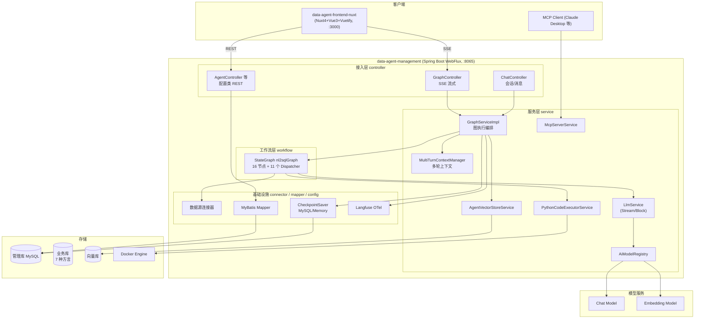

### 1.2 请求主时序（一次完整问答）

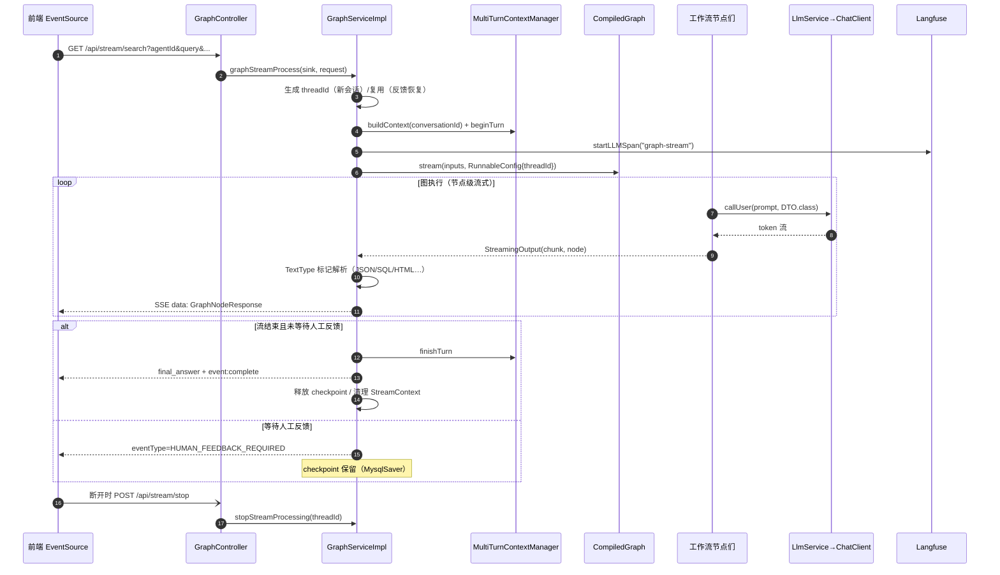

---

## 2. 工程结构与模块划分

### 2.1 仓库顶层结构

```
DataAgent/
├── data-agent-management/          # 后端（Spring Boot 单体模块）
│   └── src/main/
│       ├── java/com/alibaba/cloud/ai/dataagent/
│       │   ├── config/             # 自动配置（StateGraph、MCP、向量库…）
│       │   ├── controller/         # REST 接口层
│       │   ├── service/            # 业务服务
│       │   │   ├── graph/          # 图执行服务 + 多轮上下文
│       │   │   ├── llm/            # LlmService 抽象（Stream/Block 实现）
│       │   │   ├── vectorstore/    # 向量检索服务
│       │   │   ├── hybrid/         # 混合检索策略（ES）
│       │   │   ├── code/sandbox/   # Python 沙盒执行器
│       │   │   ├── aimodelconfig/  # 模型注册表/动态工厂
│       │   │   ├── langfuse/       # 可观测性
│       │   │   └── mcp/            # MCP Server 工具
│       │   ├── workflow/
│       │   │   ├── node/           # 16 个工作流节点
│       │   │   └── dispatcher/     # 11 个条件路由 Dispatcher
│       │   ├── connector/          # 数据源连接器（accessor/ddl/pool/impls）
│       │   ├── prompt/             # PromptHelper 模板渲染
│       │   ├── mapper/ entity/ dto/ vo/   # MyBatis 数据层
│       │   ├── properties/         # @ConfigurationProperties
│       │   └── aop/                # NodeEntryLoggingAspect
│       └── resources/
│           ├── application.yml
│           ├── prompts/            # 17 个提示词模板（.txt）
│           └── sql/                # schema.sql / data.sql / 演示数据
├── data-agent-frontend-nuxt/       # 前端（Nuxt 4 SPA）
│   └── app/
│       ├── pages/                  # dashboard/chat/agent/knowledge/system…
│       ├── components/chat/        # 聊天组件族
│       ├── composables/            # useCrudPage/useTypewriter/useEchartsRenderer…
│       ├── services/graph/         # SSE 客户端封装
│       └── stores/                 # Pinia 状态
├── docs/                           # 官方文档
├── CI/                             # checkstyle、make 脚本
└── Makefile
```

### 2.2 技术栈清单

| 层 | 技术 | 版本/说明 |
| :--- | :--- | :--- |
| 运行时 | JDK | 17+ |
| 框架 | Spring Boot | 3.4.8+（WebFlux 响应式栈） |
| AI 框架 | Spring AI Alibaba | 1.1.2.2（Graph/StateGraph、Checkpoint、Sandbox） |
| ORM | MyBatis | `map-underscore-to-camel-case` |
| 数据库 | MySQL | 5.7+（管理库；`MysqlSaver` 存图检查点） |
| 前端 | Nuxt 4 / Vue 3 / Vuetify 3 / Pinia / ECharts 6 / EventSource | pnpm 11 |
| 沙盒 | Docker + SAA Sandbox | agentscope runtime-sandbox-base 镜像 |
| 可观测 | Langfuse（OTel 协议） | 可关闭 |

### 2.3 前端架构速览（data-agent-frontend-nuxt）

- **SPA 模式**：`ssr: false`；`/api/**` 与 `/nl2sql/**` 经 Nuxt dev-server 代理到 `localhost:8065`；`/` 重定向 `/agent/new`。
- **页面**：`/chat`（问答主界面）、`/agent/new`（新建智能体）、`/knowledge/{business,agents,semantic-models}`（三层知识）、`/system/{agents,data-sources,model-config}`（系统管理）、`/prompt-config`（提示词）；`/dashboard`、`/agent/:id` 为占位页。
- **聊天组件族**（`app/components/chat/`）：`ChatSidebar`（会话管理）、`ChatMessageList`（按 messageType 分发渲染）、`ChatInputArea`（数据源/模型切换 + 人工反馈/仅NL2SQL/显示SQL结果 选项 + 计划确认面板）、`ChatWorkflowTimeline`（16 节点中文映射时间线、attempt 次数、代码高亮）、`ChatStreamingReport`（打字机流式报告）、`ChatMarkdownReport`（MD/HTML 双视图 + 下载）、`ChatResultSet`（分页结果表格）。
- **SSE 编排**（`app/stores/chat.ts` `_sendGraphRequest`）：按 `stepId+attempt` 分块累积时间线；`FINAL_ANSWER` 记最终回复；`HUMAN_FEEDBACK_REQUIRED` 弹出确认面板，`submitFeedback(rejected, content)` 复用 `threadId` 恢复图运行；多会话并行由 `sessionStateManager` 按 sessionId 隔离。
- **图表渲染链**：报告 Markdown 中 ` ```echarts ` 代码块 → `markdown-plugin-echarts` 转为带 `data-echarts-config` 的 div（流式中显示骨架屏）→ `useEchartsRenderer` 防抖扫描、JSON.parse、注入调色板、`echarts.init+setOption`；HTML 报告下载由后端 `POST /api/sessions/{id}/reports/html` 生成。
- **工程化**：`useCrudPage`（通用 CRUD 状态机）、`useTypewriter`（rAF 打字机）、`useConfirm`（全局确认框）；vitest 单测；`pnpm gen:ctx` 生成 AI 上下文文档（目录级 README）。

---

## 3. 核心机制：StateGraph 工作流引擎

### 3.1 图的构建位置

图在 `config/DataAgentConfiguration#nl2sqlGraph` 中以 Bean 方式构建：**16 个节点、11 个条件 Dispatcher、1 条 Human-in-the-loop 中断配置**。

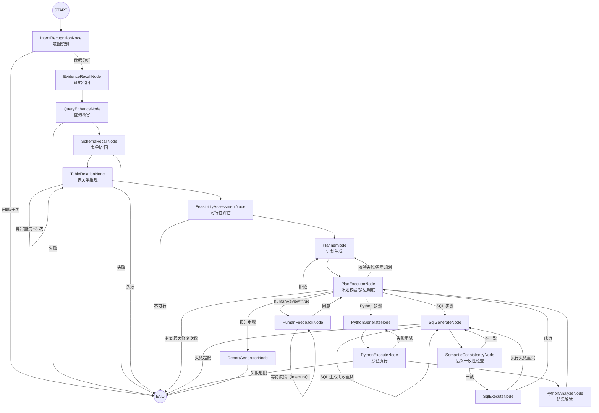

### 3.2 图定义源码要点（`DataAgentConfiguration`）

```java
StateGraph stateGraph = new StateGraph(NL2SQL_GRAPH_NAME, keyStrategyFactory)
    .addNode(INTENT_RECOGNITION_NODE, nodeBeanUtil.getNodeBeanAsync(IntentRecognitionNode.class))
    // ... 共 16 个 addNode
    .addEdge(START, INTENT_RECOGNITION_NODE)
    .addConditionalEdges(INTENT_RECOGNITION_NODE, edge_async(new IntentRecognitionDispatcher()),
        Map.of(EVIDENCE_RECALL_NODE, EVIDENCE_RECALL_NODE, END, END))
    // ... 各条件边见上图
    .addEdge(REPORT_GENERATOR_NODE, END);

// 编译配置：检查点 + 人工反馈中断点 + Langfuse 生命周期监听
@Bean
public CompileConfig nl2sqlGraphCompileConfig(BaseCheckpointSaver checkpointSaver,
        NodeTracingLifecycleListener nodeTracingLifecycleListener) {
    return CompileConfig.builder()
        .saverConfig(SaverConfig.builder().register(checkpointSaver).build())
        .interruptBefore(HUMAN_FEEDBACK_NODE)          // Human-in-the-loop 关键
        .withLifecycleListener(nodeTracingLifecycleListener)
        .build();
}

// 检查点持久化：默认 MySQL（spring.ai.alibaba.data-agent.checkpoint.type=mysql|memory）
@Bean
public BaseCheckpointSaver mysqlCheckpointSaver(StateGraph nl2sqlGraph, DataSource dataSource) {
    return MysqlSaver.builder().dataSource(dataSource)
        .stateSerializer(nl2sqlGraph.getStateSerializer())
        .createOption(CreateOption.CREATE_IF_NOT_EXISTS).build();
}
```

### 3.3 全局状态（OverAllState）Key 字典

状态 Key 在 `KeyStrategyFactory` 中统一注册（当前全部为 `KeyStrategy.REPLACE` 覆盖语义）。常量定义于 `constant/Constant.java`：

| 分组 | Key | 含义 |
| :--- | :--- | :--- |
| 输入 | `input`、`agentId` | 用户问题、智能体 ID |
| 上下文 | `MULTI_TURN_CONTEXT` | 多轮对话上下文文本 |
| 意图 | `INTENT_RECOGNITION_NODE_OUTPUT` | 意图识别 DTO |
| 证据 | `EVIDENCE`、`QUERY_ENHANCE_NODE_OUTPUT` | 召回证据文本、改写后查询 |
| 语义模型提示 | `GENEGRATED_SEMANTIC_MODEL_PROMPT` | 按召回表装配的语义模型提示文本 |
| Schema | `TABLE_DOCUMENTS_FOR_SCHEMA`、`COLUMN_DOCUMENTS__FOR_SCHEMA_OUTPUT`、`SCHEMA_RECALL_NODE_OUTPUT`、`TABLE_RELATION_OUTPUT`、`TABLE_RELATION_EXCEPTION_OUTPUT`、`TABLE_RELATION_RETRY_COUNT`、`DB_DIALECT_TYPE` | 表/列文档、召回输出、表关系结果、异常与重试计数、方言 |
| 可行性 | `FEASIBILITY_ASSESSMENT_NODE_OUTPUT` | 可行性结论 |
| 计划 | `PLANNER_NODE_OUTPUT`、`PLAN_CURRENT_STEP`、`PLAN_NEXT_NODE`、`PLAN_VALIDATION_STATUS`、`PLAN_VALIDATION_ERROR`、`PLAN_REPAIR_COUNT` | 计划 JSON、步进指针、校验状态、修复计数 |
| SQL | `SQL_GENERATE_OUTPUT`、`SQL_GENERATE_COUNT`、`SQL_REGENERATE_REASON`、`SQL_GENERATE_SCHEMA_MISSING_ADVICE`、`SQL_EXECUTE_NODE_OUTPUT`、`SEMANTIC_CONSISTENCY_NODE_OUTPUT` | SQL 及执行链路 |
| Python | `PYTHON_GENERATE_NODE_OUTPUT`、`PYTHON_EXECUTE_NODE_OUTPUT`、`PYTHON_ANALYSIS_NODE_OUTPUT`、`PYTHON_IS_SUCCESS`、`PYTHON_TRIES_COUNT`、`PYTHON_FALLBACK_MODE`、`SQL_RESULT_LIST_MEMORY` | Python 三节点链路 |
| 人工反馈 | `HUMAN_REVIEW_ENABLED`、`HUMAN_FEEDBACK_DATA`、`human_next_node` | 开关、反馈内容 `{feedback: bool, feedback_content: str}`、HumanFeedbackNode 写出的路由目标 |
| 模式 | `IS_ONLY_NL2SQL` | 仅 NL2SQL 模式 |
| 输出 | `RESULT`、`FINAL_ANSWER`、`TRACE_THREAD_ID` | 最终答案、追踪 ID |

### 3.4 节点开发模式（NodeAction SPI）

所有节点实现 `com.alibaba.cloud.ai.graph.action.NodeAction`：

```java
@Component
public class XxxNode implements NodeAction {
    @Override
    public Map<String, Object> apply(OverAllState state) throws Exception {
        // 1. StateUtil 读取输入
        String query = StateUtil.getStringValue(state, INPUT_KEY);
        // 2. PromptHelper 构建提示词（resources/prompts/*.txt 模板）
        String prompt = PromptHelper.buildXxxPrompt(...);
        // 3. LlmService 调用（可带结构化输出 DTO）
        Flux<ChatResponse> flux = llmService.callUser(prompt, XxxOutputDTO.class);
        // 4. FluxUtil.createStreamingGenerator 包装为节点流式输出
        Flux<GraphResponse<StreamingOutput>> generator = FluxUtil.createStreamingGenerator(
            this.getClass(), state, flux,
            前置显示流, 后置显示流,
            result -> Map.of(XXX_OUTPUT, 转换逻辑));   // 完成回调写状态
        return Map.of(XXX_OUTPUT, generator);
    }
}
```

**四个关键工具类**：

| 类 | 职责 |
| :--- | :--- |
| `StateUtil` | 从 `OverAllState` 安全取值（带默认值/类型转换） |
| `PromptHelper` | 渲染 `resources/prompts/` 模板 + 注入多轮上下文/用户 Prompt 配置 |
| `FluxUtil.createStreamingGenerator` | 把 LLM token 流包装成 `GraphResponse<StreamingOutput>`，支持前后缀提示语与完成回调 |
| `ChatResponseUtil` | 构造带 `TextType` 标记的响应（见 5.3 文本类型协议） |

条件路由实现 `dispatcher/` 下的 EdgeAction：读取状态中的输出 Key，返回目标节点名（如 `PlanExecutorDispatcher` 按 `PLAN_NEXT_NODE` 分发）。

---

## 4. 工作流节点参考手册

> 每个节点：职责 → 输入 → 输出 → 提示词模板（`resources/prompts/`）→ 失败行为

| # | 节点 | 职责 | 主要输入 Key | 输出 Key | 模板 | 失败/重试 |
| :-: | :--- | :--- | :--- | :--- | :--- | :--- |
| 1 | `IntentRecognitionNode` | 闲聊 vs 数据分析分类；闲聊直接给 `FINAL_ANSWER` | `input`、`MULTI_TURN_CONTEXT` | `INTENT_RECOGNITION_NODE_OUTPUT` | `intent-recognition.txt` | 结构化输出校验 Advisor（解析失败自动让模型修复，最多 2 次）；分类为《闲聊或无关指令》→ Dispatcher→END |
| 2 | `EvidenceRecallNode` | LLM 查询重写→向量召回业务知识+智能体知识→拼接证据（`[来源: xx]` 格式） | `input`、`MULTI_TURN_CONTEXT` | `EVIDENCE` | `evidence-query-rewrite.txt`、`business-knowledge.txt`、`agent-knowledge.txt` | 检索异常降级为"无" |
| 3 | `QueryEnhanceNode` | 结合证据改写查询（canonicalQuery）并扩展子查询 | `input`、`EVIDENCE` | `QUERY_ENHANCE_NODE_OUTPUT` | `query-enhancement.txt` | 解析失败→Dispatcher→END |
| 4 | `SchemaRecallNode` | 向量召回表文档（topK=10、阈值 0.2）→按表名取列文档 | 改写查询 | `TABLE_DOCUMENTS_FOR_SCHEMA`、`COLUMN_DOCUMENTS__FOR_SCHEMA_OUTPUT` | —（纯检索） | 无激活数据源/无表→END |
| 5 | `TableRelationNode` | 构建初始 SchemaDTO（含逻辑外键），LLM 精选表列并补 JOIN；按表名装配语义模型提示 | 表/列文档、`EVIDENCE`、逻辑外键 | `TABLE_RELATION_OUTPUT`、`GENEGRATED_SEMANTIC_MODEL_PROMPT`、`DB_DIALECT_TYPE` | `mix-selector.txt`、`semantic-model.txt` | 可重试异常自旋（`TABLE_RELATION_RETRY_COUNT`≤3）；超限→END |
| 6 | `FeasibilityAssessmentNode` | 判定需求类型（DATA_ANALYSIS/需澄清） | Schema、`EVIDENCE` | `FEASIBILITY_ASSESSMENT_NODE_OUTPUT` | `feasibility-assessment.txt` | 非数据分析→直接给 `FINAL_ANSWER`→END |
| 7 | `PlannerNode` | 产出 JSON 执行计划（thought_process + execution_plan[]，tool∈SQL/Python/REPORT）；NL2SQL-only 直接构造单步计划 | 全部前序输出、`PLAN_VALIDATION_ERROR` | `PLANNER_NODE_OUTPUT` | `planner.txt` | 计划非法由 PE 写入校验错误后重生成 |
| 8 | `PlanExecutorNode` | 校验计划结构 → 按 `PLAN_CURRENT_STEP` 步进调度 | 计划、`HUMAN_REVIEW_ENABLED` | `PLAN_NEXT_NODE` 等 | —（纯逻辑） | 校验失败→`PLAN_REPAIR_COUNT+1`→回 Planner；修复超限→END |
| 9 | `SqlGenerateNode` | 生成 SQL（Schema+方言+证据+语义模型）；重试时注入失败 SQL+错误+前序步骤结果（截断 8000 字符）；与失败 SQL 相同则停止 | 步骤指令、Schema、`SQL_REGENERATE_REASON` | `SQL_GENERATE_OUTPUT`、`SQL_GENERATE_COUNT` | `new-sql-generate.txt`（首）；`sql-error-fixer.txt`（重试） | 自重试≤`max-sql-retry-count`(10)；`SQL_GENERATE_OUTPUT="END"` 为终止标志 |
| 10 | `SemanticConsistencyNode` | 先做方言结构校验（`SqlUtil.findGeneratedSqlValidationError`），再 LLM 语义一致性校验 | SQL、Schema、`EVIDENCE` | `SEMANTIC_CONSISTENCY_NODE_OUTPUT` | `semantic-consistency.txt` | 不一致→`SQL_REGENERATE_REASON=semantic(reason)`→回 SQL 生成 |
| 11 | `SqlExecuteNode` | boundedElastic 上经 Accessor 执行；结果累积 `SQL_EXECUTE_NODE_OUTPUT["step_N"]`；`PLAN_CURRENT_STEP+1`；可选 LLM 生成图表配置（DisplayStyleBO，采样 20 行，15s 超时，`enable-sql-result-chart` 开关） | SQL、`agentId`、`PLAN_CURRENT_STEP` | `SQL_EXECUTE_NODE_OUTPUT`、`SQL_RESULT_LIST_MEMORY` | `data-view-analyze.txt`（可选图表） | 失败→`SQL_REGENERATE_REASON=sqlExecute(err)`→回 SQL 生成（≤10） |
| 12 | `PythonGenerateNode` | 以 Schema+每步 SQL 结果采样（5 行）+步骤指令生成含 PEP 723 头的 Python | 步骤指令、`SQL_EXECUTE_NODE_OUTPUT` | `PYTHON_GENERATE_NODE_OUTPUT`、`PYTHON_TRIES_COUNT` | `python-generator.txt` | 失败附上次代码与报错重生成（≤5） |
| 13 | `PythonExecuteNode` | 解析 PEP 723（tomlj）→调度 SAA 沙盒执行；stdout JSON 解析 | Python 代码、SQL 结果 | `PYTHON_EXECUTE_NODE_OUTPUT`、`PYTHON_IS_SUCCESS`、`PYTHON_FALLBACK_MODE` | —（执行器） | 超限→**降级模式**（输出 `{}`，`PYTHON_FALLBACK_MODE=true`）继续流程 |
| 14 | `PythonAnalyzeNode` | LLM 解读 Python 结果 | Python 输出 | `PYTHON_ANALYSIS_NODE_OUTPUT`、写 `SQL_EXECUTE_NODE_OUTPUT["step_N_analysis"]`、`PLAN_CURRENT_STEP+1` | `python-analyze.txt` | 降级模式写固定提示 |
| 15 | `ReportGeneratorNode` | 汇总生成 Markdown 报告（`$$$markdown-report` 标记包裹）；完成清空中间态，写 `RESULT`/`final_answer` | 计划+各步结果 | `FINAL_ANSWER` | `report-generator-plain.txt` + `UserPromptService` 优化配置 | — |
| 16 | `HumanFeedbackNode` | 读 `HUMAN_FEEDBACK_DATA`：批准→`human_next_node=PLAN_EXECUTOR_NODE` 并关闭 `HUMAN_REVIEW_ENABLED`；拒绝→回 Planner（反馈作为 `PLAN_VALIDATION_ERROR`，修复计数+1）；无反馈→`WAIT_FOR_FEEDBACK` 自环 | `HUMAN_FEEDBACK_DATA`、`PLAN_REPAIR_COUNT` | `human_next_node` 等 | —（纯逻辑） | 拒绝修复≥3 次→END |

> 辅助模板：`json-fix.txt`（JSON 修复）、`semantic-model.txt`（语义模型辅助）、`agent-knowledge.txt`/`business-knowledge.txt`（知识注入格式）。

---

## 5. 运行时：SSE 流式处理与多轮对话

### 5.1 GraphController（`/api/stream/search`）

- **GET**，`produces=text/event-stream`，参数：`agentId`（必填）、`query`（必填）、`conversationId`、`threadId`、`humanFeedback`、`humanFeedbackContent`、`rejectedPlan`、`nl2sqlOnly`。
- 内部创建 `Sinks.Many<ServerSentEvent<GraphNodeResponse>>` 单播 sink，`GraphServiceImpl.graphStreamProcess` 异步向 sink 推数据。
- 过滤规则：`complete`/`error` 事件放行；非 `NODE_OUTPUT` 的协议事件放行；空文本丢弃。
- `doOnCancel/doOnError` → `stopStreamProcessing(threadId)`（资源清理）。
- **POST `/api/stream/stop`**：按 `threadId`（或 `conversationId`）主动终止。

### 5.2 GraphServiceImpl 关键设计

| 机制 | 实现 |
| :--- | :--- |
| 流上下文 | `ConcurrentHashMap<threadId, StreamContext>`；StreamContext 持有 sink、Disposable、TextType、累计输出、Langfuse Span |
| 新会话 | 无 `humanFeedbackContent` → 生成新 `threadId`；`compiledGraph.stream(inputs, config)` |
| 反馈恢复 | 有 `humanFeedbackContent` → 必须携带 `threadId`；`updateState` 写入 `HUMAN_FEEDBACK_DATA` 后 `stream(null, resumeConfig)` |
| 订阅安全 | `subscribeToFlux` 用 `CompletableFuture.runAsync` + `synchronized(context)` 原子设置 Disposable，防止与清理竞态 |
| 完成处理 | `handleStreamComplete`：`finishTurn` → 检查 checkpoint 下一节点是否 `HUMAN_FEEDBACK_NODE`（是则保留 checkpoint 等待反馈，否则释放）→ 推送 `HUMAN_FEEDBACK_REQUIRED` / `final_answer` / `complete` |
| 错误处理 | `handleStreamError`：记录上游 WebClient 响应体（400/401 根因）→ discardPending → 释放 checkpoint → 推送 `event:error` |
| 停止处理 | `stopStreamProcessing`：移除 context → 结束 Langfuse span → `discardThread` → dispose 订阅 → `checkpointSaver.release` |

### 5.3 文本类型协议（TextType）

节点输出流中用**首尾标记**声明内容类型（标记形如 `$$$json` / `$$$python` / `$$$sql` / `$$$markdown-report` / `$$$result_set`，成对出现且不外发给前端），`GraphServiceImpl` 解析后前端按类型分区渲染：

| TextType | 用途 |
| :--- | :--- |
| `JSON` | 意图/改写等结构化中间输出 |
| `SQL` | SQL 语句 |
| `PYTHON` | Python 代码 |
| `HTML` | 最终 HTML 报告 |
| `MARK_DOWN` | Markdown 内容 |
| `RESULT_SET` | SQL 结果集 |
| `TEXT` | 普通提示文本 |

`GraphNodeResponse` 字段：`agentId、threadId、eventType(NODE_OUTPUT/FINAL_ANSWER/HUMAN_FEEDBACK_REQUIRED)、stepId、attempt(同名节点第几次尝试)、nodeName、textType、text、error、complete`。

### 5.4 多轮对话（MultiTurnContextManager）

- `buildContext(conversationId)`：把最近若干轮"用户问题+规划结果"拼接为上下文文本，注入各节点 Prompt（保留轮数 `maxturnhistory`，默认 5）。
- `beginTurn / appendPlannerChunk / finishTurn / restartLastTurn / discardPending`：一轮对话的完整生命周期；PlannerNode 流式块实时累积，`finishTurn` 时把「UserMessage(问题) + AssistantMessage(计划, 截断 `maxplanlength`=2000 字符)」写入记忆，作为该轮"规划结果"。
- 记忆存储：Spring AI `MessageWindowChatMemory`（窗口 = `maxturnhistory`×2 条消息），仓库为 JDBC `ChatMemoryRepository`（`spring.ai.chat.memory.repository.jdbc.initialize-schema=always` 自动建表）。

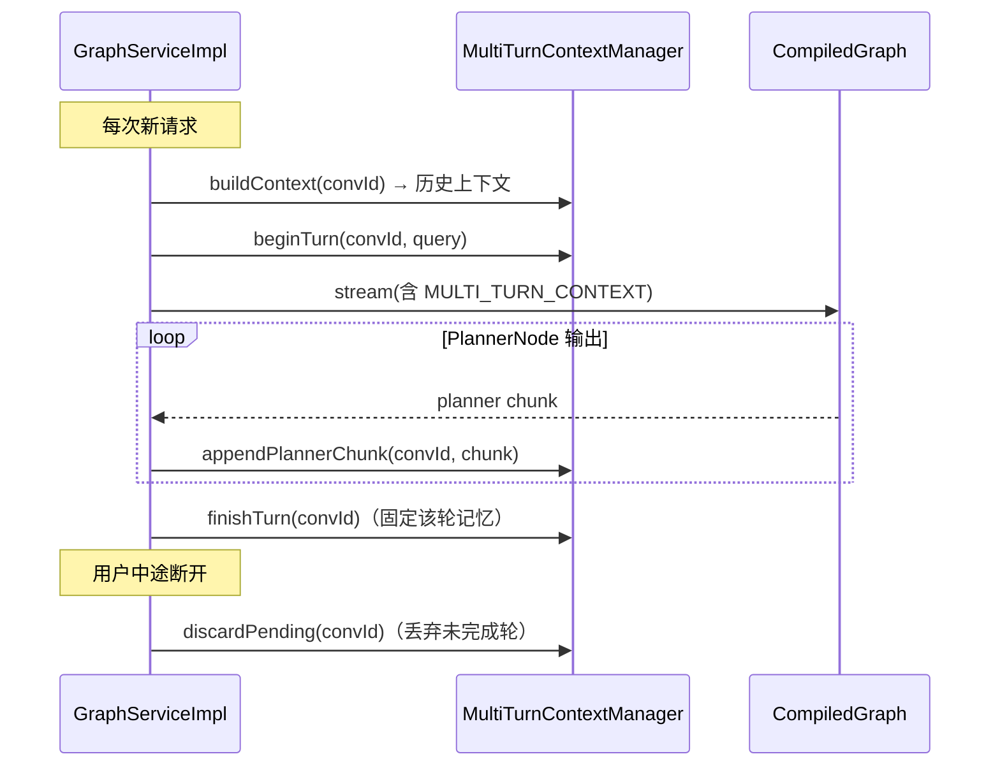

---

## 6. 人工反馈（Human-in-the-loop）实现

### 6.1 机制要点

1. **编译期**：`CompileConfig.interruptBefore(HUMAN_FEEDBACK_NODE)` —— 图执行到 HumanFeedbackNode 前强制中断。
2. **运行期首次**：`PlanExecutorNode` 检测 `HUMAN_REVIEW_ENABLED=true` → 输出 `PLAN_NEXT_NODE=HUMAN_FEEDBACK_NODE` → 图停在该节点前，checkpoint（MysqlSaver）保留 `PLAN_CURRENT_STEP` 等全部状态。
3. **流层表现**：`handleStreamComplete` 检查 `checkpointSaver.get(config)` 的 `nextNodeId` 是否为 `HUMAN_FEEDBACK_NODE`，是则向前端推 `HUMAN_FEEDBACK_REQUIRED` 事件并**不释放** checkpoint。
4. **恢复期**：前端携带 `threadId + humanFeedbackContent (+rejectedPlan)` 再次请求 → `handleHumanFeedback`：
   - 构造 `HUMAN_FEEDBACK_DATA = {feedback: !rejectedPlan, feedback_content: ...}`；
   - 拒绝时 `restartLastTurn`（多轮记忆回滚本轮）；
   - `compiledGraph.updateState(baseConfig, stateUpdate)` 注入状态 → `stream(null, resumeConfig)` 从断点继续。
5. **路由**：`HumanFeedbackDispatcher` 读 `human_next_node`：批准→PLAN_EXECUTOR_NODE 继续（并关闭 `HUMAN_REVIEW_ENABLED` 防二次中断）；拒绝→PLANNER_NODE 重新规划（反馈内容作为 `PLAN_VALIDATION_ERROR`，修复计数+1，**≥3 次终止**）；无数据→`WAIT_FOR_FEEDBACK` 自环（实际由 interruptBefore 挂起）。

### 6.2 完整时序

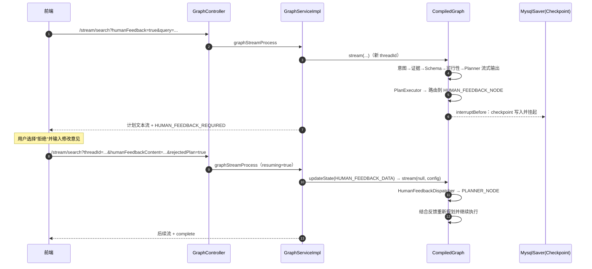

---

## 7. RAG 与向量检索体系

### 7.1 向量库抽象

- 统一依赖 Spring AI `VectorStore` 接口；默认 `MetadataAwareSimpleVectorStore`（内存实现，可序列化到 `./vectorstore/vectorstore.json`）。
- 切换持久化实现：引入 starter（Milvus/PGVector/ES…）+ 配置 `spring.ai.vectorstore.type` + 对齐 `embedding-dimension`。项目内置 `application-milvus.yml`、`application-elasticsearch.yml` 两个 Profile。
- **动态代理技巧**（`DataAgentConfiguration#embeddingModel`）：`EmbeddingModel` Bean 是 `TargetSource` 动态代理，每次调用都从 `AiModelRegistry` 取最新模型——因此向量库 Starter 拿到的是"永远热更新"的 EmbeddingModel。

### 7.2 文档元数据协议（写入向量库时固定）

`DocumentMetadataConstant` 关键字段（ES Schema 亦按此建模）：

| metadata 字段 | 类型 | 含义 |
| :--- | :--- | :--- |
| `agentId` | keyword | 归属智能体 |
| `datasourceId` | keyword | 归属数据源（表/列文档必填） |
| `vectorType` | keyword | `table` / `column` / `agentKnowledge` / `businessTerm` |
| `businessTermId` | long | 业务知识 ID |
| `agentKnowledgeId` | long | 智能体知识 ID |
| `concreteAgentKnowledgeType` | keyword | DOCUMENT / QA / FAQ |
| `name` / `tableName` | keyword | 列名 / 所属表名 |

### 7.3 检索链路

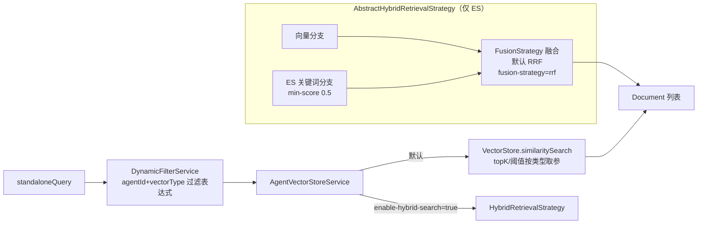

- **参数**：业务知识/智能体知识 `default-topk-limit=8`、`default-similarity-threshold=0.4`；表召回 `table-topk-limit=10`、`table-similarity-threshold=0.2`（阈值低以避免漏表）。
- **召回开关过滤**：`DynamicFilterService` 除 `agentId+vectorType` 外，还会**从 MySQL 反查 `is_recall=1` 的知识 ID 白名单**拼成 `in` 条件——"是否召回"开关即时生效，无需重建向量。
- **混合检索**：`ElasticsearchHybridRetrievalStrategy` 并行双路（ES BM25 关键词 `minScore` 阈值 + topK×2，向量分支；各分支超时 `hybrid-search-timeout-ms=3000ms`，单路失败另一路兜底），`RrfFusionStrategy` RRF 融合（**k=60**，score=Σ1/(k+rank)）。
- **Embedding 批处理**：`EnhancedTokenCountBatchingStrategy` 同时约束 token 数（默认 8000，预留 20%）与条数（默认 10）。

### 7.4 知识入库流程（向量化同步）

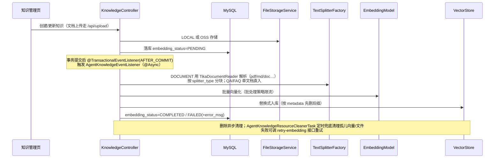

**表/列 Schema 向量化**（数据源初始化）：`POST /api/agent/{agentId}/datasources/init` → `SchemaServiceImpl.schema()`：Accessor 拉取外键+表 → `TableMetadataService` 采样丰富元数据（>5 表时并行）→ 生成 table/column 两类 Document → `replaceSchemaDocuments`（按 datasourceId 先删后插，分批 embedding）。

---

## 8. 模型管理与热切换

### 8.1 组件协作

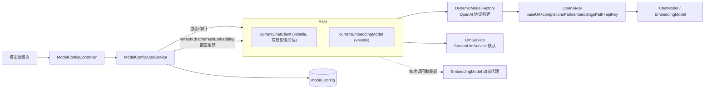

### 8.2 实现细节

- `AiModelRegistry`：`volatile` + 双检锁懒加载；`refreshChat()/refreshEmbedding()` 清空缓存实现热切换（同一时刻每类仅一个激活模型）。
- `DynamicModelFactory`：按 `model_config`（base-url、api-key、model-name、temperature、max-tokens、completions/embeddings path、代理设置）构建 Spring AI `OpenAiApi` 客户端——因此**任何 OpenAI 兼容服务**均可接入。
- `LlmService` 接口：`callUser(prompt)` / `callUser(prompt, Class<T>)`（`BeanOutputConverter` 结构化输出）；实现类 `StreamLlmService`（默认，token 级流式）与 Block 实现（`llm-service-type=STREAM/BLOCK`）。

---

## 9. 数据源连接器架构

### 9.1 SPI 设计（`connector/` 包）

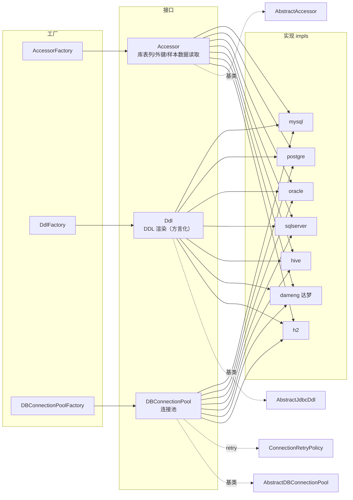

- 请求侧统一入口：`SqlExecutor` + `DbQueryParameter`，结果统一为 `ResultSetBO`（经 `ResultSetBuilder`）。
- `AbstractAccessor.accessDb()` 以方法名字符串分发到方言 `Ddl` 执行器；连接池基于 **Druid**（`AbstractDBConnectionPool` + `ConnectionRetryPolicy`）。
- `BizDataSourceTypeEnum` 枚举 16 类（含 HOLOGRESS/ADB_PG/MAX_COMPUTE 等扩展类型，访问协议 JDBC/DATA_API/FC_HTTP/MEMORY），**对外 `/api/datasource/types` 仅暴露 6 种标准 JDBC**：mysql / postgresql / dameng / sqlserver / oracle / hive（H2 为内部兜底实现）。
- 并行库表探测使用专用线程池 `dbOperationExecutor`（CPU×2，4~16 线程，队列 500，`destroy()` 优雅关闭）。

### 9.2 SQL 执行安全

- `SqlExecuteNode` 仅允许查询语义（DDL/DML 拦截），错误信息回灌 `sql-error-fixer.txt` 模板驱动下一轮修复。

---

## 10. Python 沙盒执行体系

### 10.1 模块边界（`service/code/sandbox/`）

```
service/code/sandbox/
├── SaaSandboxPythonCodeExecutorService.java  # PythonCodeExecutorService 唯一实现：
│                                             #   输入大小校验、并发队列、任务总超时
├── dependency/    # PEP 723 解析与包规格校验（拒绝 URL/VCS/路径/环境标记/pip 参数）
├── execution/     # 固定 bootstrap：installer（pip 安装）+ code runner；Base64 编码传输
└── runtime/       # SAA SandboxService 对接、任务级 BaseSandbox 生命周期
```

> 工作流只依赖接口 `PythonCodeExecutorService`；**不存在**宿主机 Local / 旧 Docker 容器池 / AI Simulation 回退路径。

### 10.2 任务生命周期

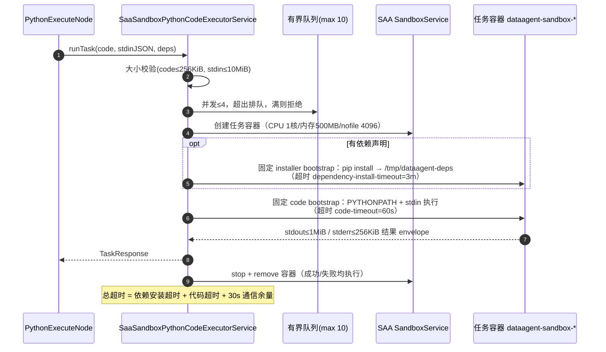

**失败语义**：安装/执行失败 → `PythonExecutorDispatcher` 判断 `PYTHON_TRIES_COUNT`：<5 则带错误信息回 `PythonGenerateNode` 重生成；达到上限 → **降级模式**（`PYTHON_FALLBACK_MODE=true`，输出 `{}`，由 `PythonAnalyzeNode` 写入固定提示）继续流程而非直接失败。结果经 `PythonAnalyzeNode` 解析后写入 `SQL_EXECUTE_NODE_OUTPUT` 供报告使用。

**结果协议**：容器内 bootstrap 以 `__DATAAGENT_RESULT_V1__:` + Base64 JSON envelope 输出结果，`SandboxExecutionResultParser` 解析；stdout/stderr 分别截断至 1MiB/256KiB。

**运行时细节**：`SaaSandboxRuntime.getOrStart()` 懒启动 SandboxService；`SandboxConfig`：type=base、securityLevel=high、runtimeConfig `{mem_limit: 500m, nano_cpus: 1核, max_connections: 4096, privileged: false}`；每任务 `new BaseSandbox(..., UUID)` try-with-resources 用完即毁；`@PreDestroy cleanupAllSandboxes()` 全量清理。

**生产安全边界**（务必落实）：
1. 镜像固定 digest + 非 root 基础镜像；
2. 网络只放行私有 PyPI 代理（SAA 1.1.2.2 无"装完断网"API，需基础设施兜底）；
3. 不向沙盒注入任何凭据；
4. 代理侧恶意包/CVE/许可证扫描。

---

## 11. MCP Server 实现

```java
// config/McpServerConfig.java
@Bean
@McpServerTool   // 自定义注解：延迟暴露，规避 ChatClient 与工具扫描的循环依赖
public ToolCallbackProvider mcpServerTools(McpServerService mcpServerService) {
    return MethodToolCallbackProvider.builder().toolObjects(mcpServerService).build();
}
```

- 传输：SSE（默认端点 `/sse`，`spring.ai.mcp.server.sse-endpoint` 可改）。
- `McpServerService` 提供 `@Tool`：
  - `nl2SqlToolCallback(agentId, naturalQuery)` → 内部走 `GraphService.nl2sql()`：以 `IS_ONLY_NL2SQL=true` **同步 `invoke`** 短路执行（意图→证据→增强→Schema 召回→表关系→可行性→SQL 生成，不含计划/报告），返回 `SQL_GENERATE_OUTPUT`；
  - `listAgentsToolCallback(keyword, status)` → 智能体列表查询。
- 调试：`npx @modelcontextprotocol/inspector http://localhost:8065/mcp/connection`。

---

## 12. 数据模型（管理库 Schema）

`resources/sql/schema.sql` 共 13 张表：

| 表 | 用途 | 关键字段/关系 |
| :--- | :--- | :--- |
| `agent` | 智能体 | `status`(draft/published/offline)、`api_key`、`api_key_enabled`、`prompt`、`tags` |
| `datasource` | 数据源 | `type`、`host/port/database`、`password`(加密)、`test_status` |
| `agent_datasource` | 智能体↔数据源 | `is_active`，唯一键(agent,datasource) |
| `agent_datasource_tables` | 选中的表 | 唯一键(agent_datasource_id, table_name) |
| `logical_relation` | 逻辑外键 | source/target 表.列、`relation_type`(1:1/1:N/N:1)、`description` |
| `semantic_model` | 语义模型 | `table_name/column_name ↔ business_name/synonyms/business_description` |
| `business_knowledge` | 业务知识 | `business_term`、`synonyms`、`is_recall`、`embedding_status` |
| `agent_knowledge` | 智能体知识 | `type`(DOCUMENT/QA/FAQ)、文件字段、`splitter_type`、`embedding_status` |
| `agent_preset_question` | 预设问题 | `sort_order`、`is_active` |
| `chat_session` / `chat_message` | 会话/消息 | `role`、`message_type`、`metadata(JSON)` |
| `user_prompt_config` | 用户提示词配置 | `prompt_type`、`agent_id`(空=全局)、`priority/display_order` |
| `model_config` | 模型配置 | `model_type`(CHAT/EMBEDDING)、`is_active`、代理字段 |

关系图：

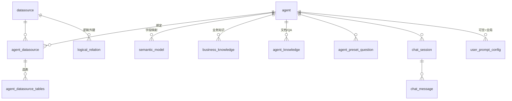

> 图检查点：`MysqlSaver` 复用同一 DataSource 建表（`CREATE_IF_NOT_EXISTS`），`checkpoint.type=memory` 可切换内存模式。

---

## 13. 配置手册

配置前缀 `spring.ai.alibaba.data-agent.*`（`@ConfigurationProperties` 见 `properties/` 包）。核心项速查：

### 13.1 通用

| 配置 | 默认 | 说明 |
| :--- | :--- | :--- |
| `llm-service-type` | STREAM | STREAM/BLOCK |
| `max-sql-retry-count` | 10 | SQL 生成/执行重试上限 |
| `max-sql-optimize-count` / `sql-score-threshold` | 10 / 0.95 | SQL 优化 |
| `maxturnhistory` | 5 | 多轮记忆轮数（ChatMemory 窗口=×2 条消息） |
| `max-columns-per-table` | 50 | 单表最大预估列数 |
| `fusion-strategy` | rrf | 融合策略 |
| `checkpoint.type` | mysql | mysql/memory |

### 13.2 向量库（`vector-store.*`）

`default-similarity-threshold=0.4`、`table-similarity-threshold=0.2`、`default-topk-limit=8`、`table-topk-limit=10`、`batch-del-topk-limit=5000`、`embedding-dimension=0`（持久化库建议=模型维度如 1024）、`enable-hybrid-search=false`（ES 生效）、`hybrid-search-timeout-ms=3000`、`elasticsearch-min-score=0.5`、`file-path=./vectorstore/vectorstore.json`。

### 13.3 文本切分（`text-splitter.*`）

全局 `chunk-size=1000`；`token`（min-chunk-size-chars=400 等）、`recursive`（overlap=200）、`sentence`（overlap=1）、`semantic`（min/max=200/1000、阈值 0.5）、`paragraph`（overlap-chars=200）五种策略独立配置。

### 13.4 代码执行器（`code-executor.*`）

`code-timeout=60s`、`limit-memory=500`、`cpu-core=1`、`python-max-tries-count=5`；`sandbox.*`：`docker-host`、`image-name`、`container-prefix=dataagent-sandbox-`、`max-concurrency=4`、`queue-capacity=10`、`max-code-bytes=256KiB`、`max-input-bytes=10MiB`、`max-output-bytes=1MiB`、`max-error-bytes=256KiB`、`max-dependencies=20`、`package-index-url`（环境变量 `DATAAGENT_PYPI_INDEX_URL`）、`dependency-install-timeout=3m`、`max-connections=4096`。

### 13.5 其他

- 文件存储 `file.*`：LOCAL/OSS、`path=uploads`、`url-prefix=/uploads`、图片上限 2MB；OSS 五项环境变量。
- Langfuse `langfuse.*`：`enabled/host/public-key/secret-key`（环境变量 `LANGFUSE_*`）。
- 报告资源 `report-template.*`：marked.js / ECharts CDN 地址。
- REST/WebClient 超时：`rest.connect.timeout` / `rest.read.timeout` / `webclient.response.timeout`（默认 600s）。
- Spring `codec.max-in-memory-size=10MB`（SSE 大报文）、`webflux.multipart` 10MB。

---

## 14. API 速查

| 方法&路径 | 说明 |
| :--- | :--- |
| `GET /api/stream/search`（SSE） | 发起问答；参数见 5.1（**受 API Key 鉴权保护，见 15.4**） |
| `POST /api/stream/stop` | 终止运行 |
| `GET /api/agent/{agentId}/sessions/stream`（SSE） | 会话列表变更推送（`title-updated` 事件，标题异步生成） |
| `POST /api/agent/{id}/sessions`、`GET /api/sessions/...`、`POST /api/sessions/{id}/messages` | 会话/消息 |
| `POST /api/sessions/{id}/reports/html` | 导出 HTML 报告（blob 下载） |
| `/api/agent` CRUD + 发布/下线 + API Key 生成/重置/启停/掩码查询 + 预设问题 | 智能体 |
| `/api/datasource`（CRUD、`GET /types`、测试连接、选表、逻辑外键、初始化） | 数据源 |
| `/api/agent/{agentId}/datasources` | 智能体数据源绑定 |
| `/api/business-knowledge`、`/api/agent-knowledge`（上传/分块/向量化/召回开关/统计）、`/api/semantic-model`（含 Excel 批量导入与模板下载） | 知识三层 |
| `/api/model-config`（CRUD、`POST /activate/{id}`、`POST /test/{id}`、`GET /check-ready`） | 模型 |
| `/api/prompt-config` | 用户提示词 |
| `/api/upload` | 文件上传（头像等） |
| `/swagger-ui.html` | OpenAPI 文档 |
| `/echo/ok` | 健康探针 |

---

## 15. 扩展开发指南

### 15.1 新增一种向量库

1. `data-agent-management/pom.xml` 引入 Spring AI 对应 starter（如 `spring-ai-starter-vector-store-pgvector`）。
2. `application.yml` 或新 Profile 配置连接参数与 `spring.ai.vectorstore.type`（值查对应 `*VectorStoreAutoConfiguration`）。
3. 设置 `vector-store.embedding-dimension` 与嵌入模型维度一致（启动时校验）。
4. 自建 Schema 时严格按 7.2 的 metadata 字段类型建模（参考 docs 中的 ES mapping）。

### 15.2 新增一种数据源方言

1. 在 `connector/impls/<name>/` 实现 `Accessor`、`Ddl`、`DBConnectionPool`（可继承 Abstract 基类）。
2. 注册到对应 Factory；在数据源类型枚举/DTO 中加入类型标识。
3. 为 `SqlGenerateNode` 的方言提示补充该库 SQL 特性说明（`DB_DIALECT_TYPE`）。

### 15.3 新增一个工作流节点

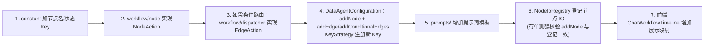

注意事项：
- 节点 IO 登记有 **`NodeIoRegistryTest` 强约束**（解析 `DataAgentConfiguration` 的 `addNode` 调用并断言全部登记，漏登测试失败）。
- 流式节点务必走 `FluxUtil.createStreamingGenerator` 并用 `TextType` 标记包裹结构化输出，否则前端渲染与 `MultiTurnContextManager` 采样会错位。
- 状态 Key 一律 `REPLACE` 策略；跨步骤累积请显式回写（参考 `SQL_RESULT_LIST_MEMORY`）。

### 15.4 API Key 鉴权机制（已内置，范围有限）

代码已内置基于 WebFlux Security 的 API Key 鉴权链，**当前仅保护 `GET /api/stream/search` 一个端点**：

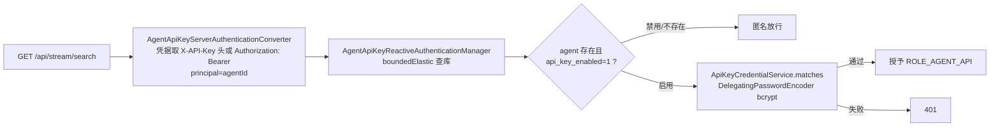

- **凭据存储**（`security/ApiKeyCredentialService`）：`agent.api_key` 存 `<{bcrypt}哈希>::<明文后4位>`，后 4 位供界面掩码展示；`matches` 兼容历史明文（恒时比较）。
- **开关语义**：`api_key_enabled=0` 时该端点**匿名放行**（鉴权关闭）；`=1` 时强制校验。
- **扩展**：若需保护更多端点，修改 `WebFluxSecurityConfiguration.STREAM_SEARCH_PATH` 附近的 matcher，或按同样模式为其他路径注册 `AuthenticationWebFilter`。

> ⚠️ 官方文档（ADVANCED_FEATURES.md）描述为"尚未在后端对 X-API-Key 做权限校验"，与当前代码（`config/WebFluxSecurityConfiguration.java`）不一致，以代码为准——官方文档描述的是早期版本行为。

### 15.5 替换 LlmService

实现 `LlmService` 接口并注册为 Bean（`@ConditionalOnMissingBean(LlmService.class)` 让位）：可接入重试、限流、多模型路由、Prompt 网关等企业能力。

---

## 16. 可观测性与调试

### 16.1 Langfuse 追踪

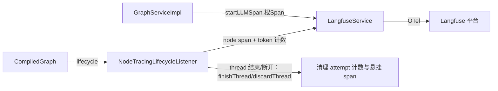

- 根 Span：`graph-stream` / `graph-feedback`；节点级 Span 由 `NodeTracingLifecycleListener`（CompileConfig lifecycle）驱动；Token 用量按线程累加后随根 Span 上报。
- 传输：`OtlpHttpSpanExporter` → `<langfuse-host>/api/public/otel/v1/traces`（Basic 认证 publicKey:secretKey），`service.name=data-agent`，BatchSpanProcessor（1s/100 条）。
- 断开路径单独处理（`discardThread`），避免悬挂 Span 与计数泄漏。
- 关闭：`langfuse.enabled=false` → `OpenTelemetry.noop()` 零开销。

### 16.2 本地调试技巧

- PlantUML 全图：启动日志输出 `workflow in PlantUML format as follows`，可直接渲染查看当前图拓扑。
- 节点入口 AOP：`aop/NodeEntryLoggingAspect` 打印节点进入日志。
- SSE 调试：`curl -N "http://localhost:8065/api/stream/search?agentId=1&query=..."` 观察 event 流。
- 上游 400/401：`GraphServiceImpl.handleStreamError` 会打印厂商响应体。
- Swagger：`/swagger-ui.html`。
- 残留容器检查：`docker ps -a --filter name=dataagent-sandbox-`（正常应为空）。

---

## 17. 测试与工程规范

### 17.1 测试矩阵

| 类型 | 示例 | 运行 |
| :--- | :--- | :--- |
| 节点/分发器单测 | `SqlGenerateNodeTest`、各 `*DispatcherTest` | 无需 Docker |
| 沙盒单测 | `PythonDependencyMetadataParserTest`、`SaaSandboxPythonCodeExecutorServiceTest` 等 | 无需 Docker |
| 沙盒集成测试 | `SaaSandboxTaskRunnerIT` | 需 Docker 在线 |
| 强约束测试 | `NodeIoRegistryTest`（节点登记一致性） | 始终 |
| 集成测试 | Testcontainers（`*IT.java`，profile `integration`） | Docker |
| 真实模型联调 | `DeepSeekModelLiveIT`、`DashScopeEmbeddingLiveIT`（profile `live-model`） | 需 API Key |

覆盖率门槛（JaCoCo）：BUNDLE LINE≥75%、BRANCH≥69%，security/aimodelconfig/knowledge/connector 等核心包≥80%。

```bash
# Python 链路单测
./mvnw -pl data-agent-management -Dtest='PythonDependencyMetadataParserTest,...' test
# 真实沙盒 IT
./mvnw -pl data-agent-management -Dtest=SaaSandboxTaskRunnerIT test
# CI 对齐检查
make format-check && make checkstyle-check && make test
```

### 17.2 规范要点

- Java：4 空格缩进、120 列、公共 API 必须 JavaDoc、checkstyle 强校验（含 license header）。
- TS/Vue：2 空格、interface 优先、禁 any、ESLint+Prettier；前端规范见 `data-agent-frontend-nuxt/.cursor/rules/`。
- 验收口径：端到端验收不能只看 HTTP 200——SSE 必须收到 `event:complete`、时间线完整、无残留沙盒容器。

---

## 18. 代码规模统计

> **统计快照时间**：2026-10-24 ｜ **统计范围**：`data-agent-management/src`（Java）+ `data-agent-frontend-nuxt/app`（TS/Vue）+ `resources/{prompts,sql}`
> **口径说明**：见 [18.5 统计口径与复现](#185-统计口径与复现)。函数/方法数为**正则估算值**（±小误差），非编译期精确值，用于规模感知与趋势对比。

### 18.1 总览

| 区域 | 文件数 | 行数 | 函数/方法数 | 备注 |
| :--- | ---: | ---: | ---: | :--- |
| 后端主代码（`src/main/java`） | 303 | 32,030 | 1,173 | 非空行 27,332；方法 = 带修饰符签名 1,063 + mapper 接口方法 110 |
| 后端测试代码（`src/test/java`） | 177 | 30,241 | 1,691 | 按 `@Test / @ParameterizedTest / @RepeatedTest` 注解精确计的测试方法 |
| 前端主代码（TS，非测试） | 33 | 4,951 | 165 | services / composables / stores / utils 等 |
| 前端测试（vitest `*.test.ts`） | 6 | 368 | 2 | 用例以 `it/test` 回调组织，未按函数单列 |
| 前端页面与组件（Vue） | 30 | 10,627 | ~165 | pages 15 ／ components 12 ／ layouts 1 ／ 根组件 2 |
| **代码合计** | **549** | **78,217** | **≈1,500（非测试）／ ≈3,190（含测试）** | 非测试 ≈ 后端 1,173 + 前端 ~331 |
| 资源：提示词模板（`prompts/*.txt`） | 17 | 920 | — | 对应第 4 章节点模板（17 个 `.txt`） |
| 资源：数据库脚本（`sql/*.sql`） | 8 | 977 | — | 管理库 schema/data + 演示业务库 + H2 脚本 |
| **项目合计** | **574** | **80,114** | — | — |

**代码行数分布（按区域）：**

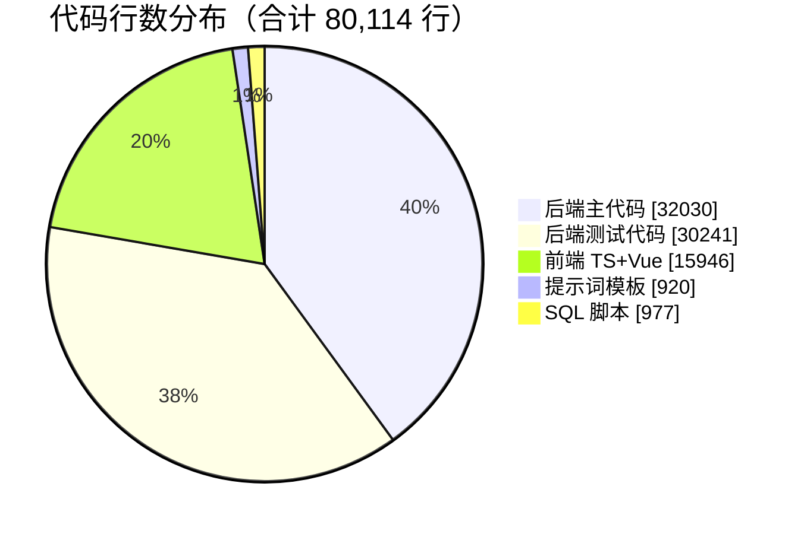

### 18.2 后端按包分布（主代码）

| 包 | 文件数 | 行数 | 方法数 | 职责对照 |
| :--- | ---: | ---: | ---: | :--- |
| `service` | 84 | 10,747 | 399 | 业务服务（graph / llm / vectorstore / code / mcp 等子包，见第 5~11 章） |
| `connector` | 34 | 3,999 | 200 | 数据源连接器（第 9 章，7 种方言实现） |
| `workflow` | 27 | 3,362 | 76 | **16 个节点（2,756 行 / 63 方法）+ 11 个 Dispatcher（606 行 / 13 方法）** |
| `controller` | 15 | 2,323 | 104 | REST 接口层（第 14 章 API 速查） |
| `util` | 17 | 1,724 | 71 | StateUtil / FluxUtil / PromptHelper / JsonParseUtil 等工具 |
| `dto` | 33 | 1,652 | 19 | 传输对象（planner / prompt / datasource 等子包） |
| `mapper` | 13 | 1,473 | 110 | MyBatis 注解 SQL 接口（无 XML，方法全在接口签名上） |
| `config` | 7 | 955 | 32 | 自动配置（StateGraph / MCP / 安全 / OTel 等） |
| `entity` | 12 | 891 | 7 | 数据库 PO（Lombok 注解为主，手写方法极少） |
| `splitter` | 3 | 787 | 27 | 语义 / 句子 / 段落切分器 |
| `enums` | 10 | 754 | 29 | TextType / KnowledgeType / ModelType / BizDataSourceTypeEnum 等 |
| `vo` | 12 | 674 | 22 | GraphNodeResponse / ApiResponse 等出参 |
| `properties` | 4 | 526 | 1 | `@ConfigurationProperties` 配置类 |
| `prompt` | 3 | 512 | 37 | PromptLoader / PromptConstant / PromptHelper |
| `bo` | 9 | 382 | 1 | Schema / ResultSet 业务对象 |
| `security` | 4 | 262 | 14 | API Key 凭据服务与鉴权链（见 15.4） |
| `converter` | 3 | 241 | 7 | 实体↔DTO 转换器 |
| `event` | 3 | 190 | 5 | 知识入库 AFTER_COMMIT 事件 |
| `constant` | 2 | 219 | 2 | 状态 Key / 文档元数据常量 |
| `annotation` | 3 | 139 | 2 | `@McpServerTool` / `@InEnum` 自定义注解 |
| `strategy` | 1 | 74 | 2 | Embedding 批处理策略 |
| `exception` | 2 | 58 | 3 | 业务异常 |
| `aop` | 1 | 56 | 2 | 节点入口日志切面 |

（注：`service` 的 84 个文件含全部子包递归计数；`workflow` 的 27 个文件 = 16 节点 + 11 Dispatcher，与第 4 章节点手册一一对应。）

### 18.3 前端按目录分布（`app/`）

| 目录 | 文件数 | 行数 | 函数数 | 内容 |
| :--- | ---: | ---: | ---: | :--- |
| `pages` | 15 | ~6,006 | ~111 | 15 个页面（含 `agent/[id].vue` 占位页 25 行） |
| `components` | 12 | 3,806 | 44 | 聊天组件族 + 通用组件 |
| `services` | 18 | 3,106 | 106 | API 封装（graph / chat / datasource / knowledge 等） |
| `stores` | 2 | 732 | 22 | Pinia：`chat.ts`（SSE 编排核心）与 `tips` |
| `layouts` | 1 | 632 | 9 | 全局侧边抽屉布局 |
| `composables` | 4 | 514 | 23 | useCrudPage / useTypewriter / useEchartsRenderer / useConfirm |
| `utils` | 13 | 919 | 16 | markdown 插件 / 时间线工具 / HTML 报告模板（含 6 个测试文件） |
| `plugins` | 1 | 31 | 0 | `$tip` 插件 |

（注：目录内 `README.md` 为 `pnpm gen:ctx` 生成的 AI 上下文文档，不计入代码统计。）

### 18.4 关键解读

1. **测试密度高**：测试行数 / 主代码行数 ≈ **0.94**，测试方法 1,691 个，与第 17 章 JaCoCo 门槛（BUNDLE LINE≥75%、BRANCH≥69%）互为印证——改核心代码前先看有没有对应测试。
2. **业务重心在 `service` 包**：占后端主代码 33.6%（10,747 / 32,030），其中图执行、向量检索、沙盒执行三个子域最复杂（分别对应第 5、7、10 章）。
3. **工作流薄而清晰**：`workflow` 包 27 个文件仅 3,362 行——节点普遍遵循"取状态 → 拼 Prompt → 调 LLM → 包流式 → 写状态"模板（见 6.2 节解剖），单个节点平均不足 200 行。
4. **MyBatis 无 XML**：13 个 mapper 接口 110 个方法全部为注解 SQL（`@Select/@Insert…`），数据访问层一眼可读。
5. **前端逻辑集中在 `stores/chat.ts` 与 `services/`**：SSE 编排、人工反馈恢复、多会话状态机都在 Pinia store 中（见 2.3 节），页面组件偏展示。
6. **Lombok 影响口径**：PO/DTO 大量使用 `@Data/@Builder/@AllArgsConstructor`，编译期生成的 getter/setter/builder 不在源码统计内——`entity` 包 12 个文件仅 7 个手写方法属正常现象。

### 18.5 统计口径与复现

统计基于 PowerShell 正则扫描（2026-10-24 快照），核心口径：

| 指标 | 口径 |
| :--- | :--- |
| 文件数 / 行数 | `Get-ChildItem -Recurse -Filter` 枚举 + `Get-Content` 逐文件累加物理行（含空行与注释） |
| Java 方法 | 行匹配 `^\s*(public\|private\|protected)\s+[\w<>\[\],\.\s]+\(`（含构造器）；mapper 接口另计 `^\s*\w[\w<>\[\],\.\s]*\s+\w+\s*\(.*\)\s*;` |
| 测试用例 | 行精确匹配 `^\s*@(Test\|ParameterizedTest\|RepeatedTest)\s*$`（排除 `@TestConfiguration` 等前缀注解） |
| TS/Vue 函数 | 行匹配 `function \w+`、`const \w+ = (async )?(`、修饰符方法、带类型标注的类方法 |

复现示例（后端主代码"文件数 / 行数 / 方法数"）：

```powershell
$base = "D:\workspace\8_ai_project\DataAgent\data-agent-management\src\main\java\com\alibaba\cloud\ai\dataagent"
$files = Get-ChildItem -Path $base -Recurse -Filter *.java
$tf=0; $tl=0; $m=0
foreach ($f in $files) {
  $lines = Get-Content $f.FullName
  $tf++; $tl += $lines.Count
  $m += ($lines | Where-Object { $_ -match '^\s*(public|private|protected)\s+[\w<>\[\],\.\s]+\(' }).Count
}
"files=$tf lines=$tl methods=$m"
# 输出: files=303 lines=32030 methods=1063 （mapper 接口 110 个方法需按 18.5 口径另加）
```

> 正则估算与编译期统计（IDE Structure View、`cloc`、JaCoCo 类计数）会有个位数到低两位数的偏差，用于规模感知足够，请勿用于考核类精确场景。

---

## 附：与本项目其他文档的关系

| 文档 | 侧重 |
| :--- | :--- |
| `产品文档.md` | 功能、场景、运营 |
| `开发文档.md`（本文） | 架构实现、扩展开发 |
| `学习文档.md` | 概念入门、环境搭建、动手实验 |
